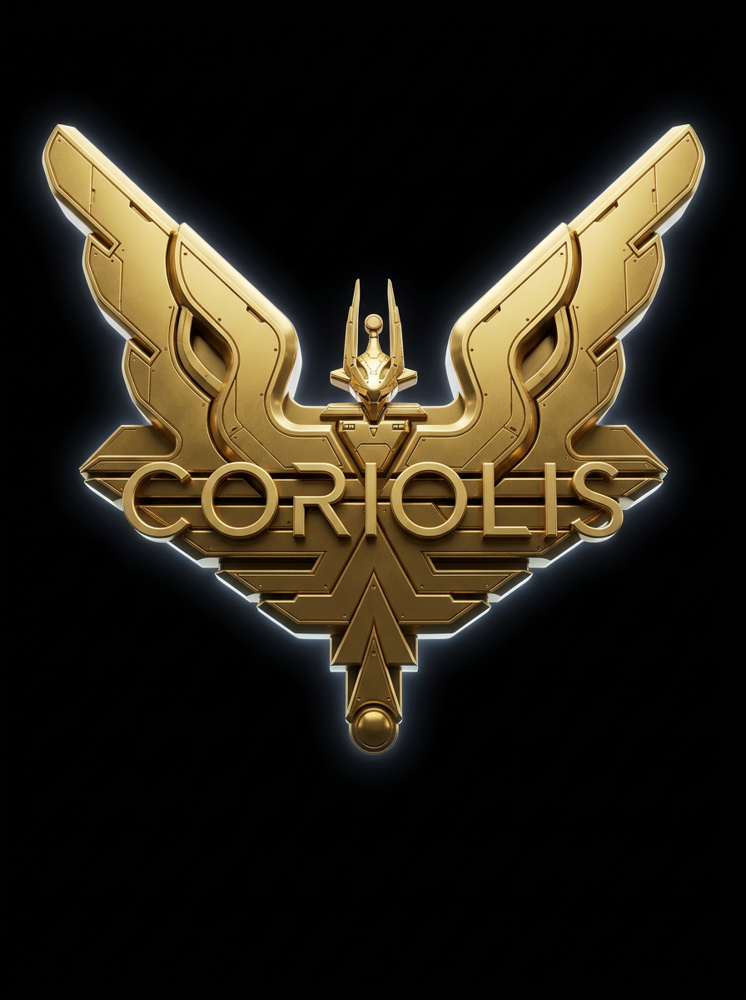
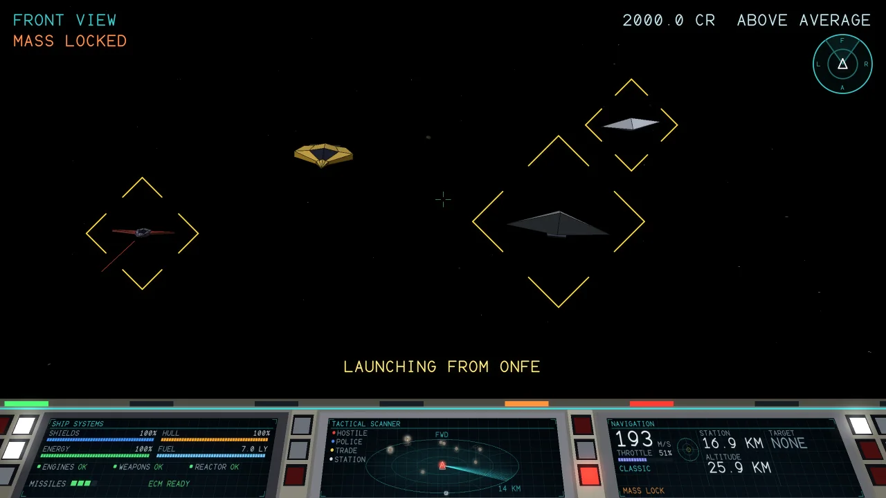

<p align="center">
  
</p>

# Coriolis

The start of an open source version of the space trading game Elite.

This is a **playable game**, a **game engine** and a **ship rendering engine**. The game engine plays the whole of the
Elite loop: flight, laser and missile combat with AI pilots, traffic, stations and docking, eight galaxies of 256
systems each with hyperspace between the systems, markets and trading, equipment, legal status, combat rank and saving. A computer pilot plays
it from end to end in the tests. In front of it is a software rendered 3D cockpit (a clear view out of the ship with a
console of computer screens along the bottom fifth), the screens of the station, and a window with keyboard and Xbox
controller support (needs SDL2), and FM synthesized sound effects. What it does not have yet is missions. The rendering engine draws solid,

flat shaded 3D models of 36 ships, the 13 of the original game's first ship list and the further ships of its later
versions, with a small software rasteriser into an RGB picture.



## Documentation

The game guide, with pictures of every ship, station, upgrade, trade good and world, is at
**https://ross-newman.github.io/coriolis/**:

- [Playing](https://ross-newman.github.io/coriolis/playing/): controls, flying, docking, trading and fighting
- [Ships](https://ross-newman.github.io/coriolis/ships/), [Stations](https://ross-newman.github.io/coriolis/stations/)
  and [Worlds](https://ross-newman.github.io/coriolis/planets/)
- [Upgrades](https://ross-newman.github.io/coriolis/upgrades/) and
  [Trade goods](https://ross-newman.github.io/coriolis/trade-goods/)

The rest of this page is for people who build, change or use the code. The site is built from `docs/` with MkDocs
and published by GitHub Actions on every push to `main`; the pictures and pages are made by `site_gen`
(`tools/make_site.sh`).

## What is here

| Part | Where | What it does |
| --- | --- | --- |
| Ship models | `src/ships.cpp` | The 36 ships, built from vertices and polygons with `ModelBuilder` |
| Model builder | `include/coriolis/model_builder.h` | Helpers for hulls, rings, bands, fans, boxes; recentres and scales a ship |
| Renderer | `src/renderer.cpp` | Perspective projection, depth buffer, flat shading with a highlight, outlined edges, supersampling |
| Star field | `src/stars.cpp` | Three layers of stars drifting at different speeds, twinkling |
| Text | `src/text.cpp` | A vector stroke font (capitals, digits, lower case) drawn as smooth anti-aliased lines at any size |
| Showcase | `src/showcase.cpp` | Each ship in turn (30 seconds each by default), driven by elapsed time |
| PNG writer | `src/png.cpp` | Writes a picture as an uncompressed PNG, so there are no dependencies |
| Ship viewer | `apps/ship_viewer` | Draws the ships to PNG files |
| Game engine | `include/coriolis/game.h` and others | See [The game engine](#the-game-engine) |
| Engine demo | `apps/engine_demo` | A computer pilot plays the game and prints what happens |
| Cockpit | `cockpit.h`, `src/cockpit.cpp` | The flight view: a clear view out of the ship (stars, planet and sun, solid ships and stations, bolts, explosions, target brackets) over the top four fifths, and a 3D console in the bottom fifth with a ship systems screen, a 3D scanner and a navigation screen, painted in the colours of the player's ship |
| Screens | `screens.h` | The station screens: status, market, equipment (with a 3D model of the item), galactic chart, data on a system |
| Game UI | `ui.h`, `src/ui.cpp` | The title, the station screens with buying and selling, the chart, flight, pause and saving, with no window so it can be tested |
| Flight view | `apps/flight_view` | The computer pilot plays and the cockpit and screens are saved as PNG files |
| The game | `apps/play` | The game in a window (SDL2): `coriolis_game` |
| Sound | `adlib_synth.h`, `sound.h` | An AdLib style FM synthesizer with the game's sound design (52 effects and an engine drone; 12 are the original's), and a mixer; `apps/sound_demo` writes the effects as WAV files |

The library has no dependencies beyond a C++17 compiler and CMake.

## Build

```bash
cmake -S . -B build
cmake --build build -j
ctest --test-dir build
```

Each release has a `.deb` of the game for Ubuntu 24.04 and one for Ubuntu 26.04 (pick the one for your release):

```bash
sudo apt install ./coriolis_0.1.0-1_ubuntu24.04_amd64.deb
coriolis_game
```

To make one yourself, build with SDL2 installed and run `cpack` in the build directory (`-DCORIOLIS_DISTRO=ubuntu24.04`
puts the release in the file name). The packages are built by `.github/workflows/deb.yml`, and pushing a tag such as
`v0.2.0` attaches them to a GitHub release.

## Playing

With SDL2 installed (`libsdl2-dev`) the build makes `coriolis_game`:

```bash
./build/coriolis_game                      # 960x540, saves to ~/.coriolis_save.json
./build/coriolis_game --size 1280x720 --quality 2 --fullscreen
./build/coriolis_game --no-save --seed 7   # no saving, the same galaxy of traffic
```

`--size` is the size the game is drawn at (it is scaled to the window), `--quality 1-4` draws that many times bigger and
shrinks for smooth edges (slower), and `--invert-pitch` swaps the pitch keys. Quality 1 runs at 60 frames a second at
960x540 on one core. The game saves when you dock and when you press S in the station, and the title offers to continue
the saved game.

| Keys in flight | |
| --- | --- |
| Arrows | Pitch (down is nose up) and roll |
| Q / E | Roll left and right (the same as the left and right arrows) |
| A / D | Yaw left and right |
| W / S | Throttle up and down |
| X / Z | Throttle straight to full / straight to nothing |
| Hold Shift | Fine control, for lining up a shot (turns at a third of the rate) |
| Space | Fire lasers |
| T / M | Lock a missile on the target / fire it |
| Tab / Shift+Tab | Next and previous target |
| C / B | ECM / energy bomb |
| H | Hyperspace (choose a system on the chart with G first) |
| K / Y / N | Docking computer / flight assist / classic or Newtonian flight |
| 1 2 3 4 | Front, rear, left and right views |
| G | Galactic chart (the game waits while it is open) |
| P or Esc | Pause menu |
| F1 | The list of keys, in the game |
| Hold Backspace | Eject in the escape pod |

The turn keys ease in over a sixth of a second, so a tap is a small correction and holding is a full turn. Launching
rides the ship out of the station's docking bay: for the first few seconds it is carried along the bay with the
controls locked, and then the pilot has it.

In the station: Tab (or Shift+Tab) changes screen, arrows and Enter choose and buy, Backspace sells (or clears the
destination on the chart), L launches, S saves, Esc is the menu. F11 or Alt+Enter turns full screen on and off. The Xbox controller works in the
menus too: D-pad, A to choose, X to sell, Y to launch, LB/RB for the screens.

The flight view has no frame round it: all of the upper four fifths is the view out of the ship, with a few lines of
text. Ships are not as fast to draw as on a GPU, so the cockpit is rendered in software; `flight_view` shows what it
looks like without a window:

```bash
./build/flight_view --seed 6 --seconds 60 --every 10 --size 1280x720 --quality 2 --out /tmp/fv
```

## Ship viewer

```bash
./build/ship_viewer --ship all --size 1280x720 --out /tmp/ships   # every ship
./build/ship_viewer --ship 4 --angle 2.36 --out .                 # the Cobra Mk III bounty hunter
./build/ship_viewer --showcase 90 --size 640x360 --out /tmp/show  # a picture a second for 90 seconds
./build/ship_viewer --obj my_model.obj --out /tmp                 # your own Wavefront OBJ, drawn to /tmp/obj.png
./build/ship_viewer --items --out /tmp/items                      # the things for sale, item_00.png ...
./build/ship_viewer --asteroids 6 --size 1200x800 --out /tmp      # a sheet of generated asteroids, asteroids.png
```

`LoadObj()` in `coriolis/obj.h` reads an OBJ file into a `Model` (vertices, faces of any size, and the `Kd`/`Ke`
colours of its `.mtl`). It assumes the usual "Y up, -Z forward" export and turns it into the nose-along-+z of the
ships here; `--keep-z` leaves the axes alone and `--flip-winding` turns the faces round. Only use models whose licence
lets you do so: none are bundled.

## The things for sale

`GetItemModel(Item)` in `coriolis/equipment_models.h` gives a 3D model, in the style of the ships, of everything on
the equipment screen: the fuel tank, missile, E.C.M. unit, escape pod, fuel scoop, energy bomb, docking computer, and
the beam and military lasers. The missile and escape pod are the ship models; the rest are made for the screen, which
draws the highlighted item under the list.

## Trade goods

`GetCommodityModel(Commodity)` in `coriolis/commodity_models.h` gives a 3D model of each of the 17 trade goods: a crate
of food, rolls of textiles, a hazard-striped barrel of radioactives, a cage, a bottle of liquor, a gift box, a pill
bottle, a monitor, a gear, a bundle of alloy rods, a rifle, a pelt, mineral crystals, stacked gold and platinum bars, a cut
gem and a glowing alien relic. The market screen draws the highlighted good to the right of the list when the picture
is wide enough. `ship_viewer --goods --out DIR` draws them all. The parts they are built from (tubes, balls, plates,
crystals) are in `coriolis/model_parts.h`.

## Asteroids

`coriolis/asteroids.h` makes asteroids from a seed: a split 20 sided shape pushed in and out by lumps, craters and
bumps, then stretched and flattened, in rocky, metallic, icy or dark colours. There are five size classes, from
splinters of 8 metres to giants of nearly a kilometre. The blueprint's size, mass, hull and the minerals it drops come
from the radius and type. Each system has its own asteroid field, the same every visit, with debris round the big
rocks; the spawner keeps the rocks it has made in an `AsteroidCatalog`.

## Using the library

```cpp
#include "coriolis/png.h"
#include "coriolis/renderer.h"
#include "coriolis/ships.h"

using namespace coriolis;

Image image(1280, 720);
DrawStars(image, /*frame=*/0);
Renderer().DrawShip(image, GetShip(ShipId::kCobraMk3Trader), /*angle=*/1.0f);
DrawCaption(image, "COBRA MK III TRADER");
WritePng(image, "cobra.png");
```

`Showcase` does the same for a whole show: `Showcase().Render(image, elapsed_seconds)` draws the ship that is on
show after `elapsed_seconds`, turned and with the stars drifted to match. It takes the time as an argument rather
than reading the clock, so the same time always gives the same picture.

## The ships

In the order of the ship list of the original cassette version for the first 13, then the further ships that the
later versions added, including the Elite logo and the pirate paint of the Cobra Mk III and the Python. The Cobra
Mk III entries share a model and differ only in paint, and so do the Pythons.

| # | Ship | Notes |
| --- | --- | --- |
| 0 | Sidewinder | Small kite shaped fighter |
| 1 | Viper | Police interceptor |
| 2 | Mamba | Long, slim, three engines |
| 3 | Python | Heavy freighter |
| 4 | Cobra Mk III (bounty hunter) | Modelled from a three view silhouette |
| 5 | Thargoid | Octagonal alien ship |
| 6 | Cobra Mk III (trader) | Same model, different paint |
| 7 | Coriolis station | A cuboctahedron with a docking slot, rolls about its own axis |
| 8 | Missile | |
| 9 | Asteroid | A roughened icosphere |
| 10 | Cargo canister | |
| 11 | Thargon | |
| 12 | Escape pod | |
| 13 | Alloy plate | A hexagonal slab of hull plating |
| 14 | Boulder | Rock, not split, so it looks rougher |
| 15 | Splinter | A long thin sliver of rock |
| 16 | Shuttle | Boxy civilian craft with short wings |
| 17 | Transporter | Long hauler with containers on its back |
| 18 | Boa | Heavy freighter, wide, three engines |
| 19 | Anaconda | Very long, narrow, with a dorsal turret |
| 20 | Rock hermit | A rock with a lit docking bay in its front |
| 21 | Cobra Mk I | Short, plain forerunner of the Mk III |
| 22 | Adder | Boxy twin engine trader |
| 23 | Krait | Slim dart with swept red wings |
| 24 | Gecko | Small kite shaped fighter with a canopy |
| 25 | Worm | Stubby insect-like body with side pods |
| 26 | Asp Mk II | Sleek explorer with swept wings |
| 27 | Fer-de-lance | Long dagger with gold wings |
| 28 | Moray | Wide, flat, saucer-like boat |
| 29 | Constrictor | Heavy, angular, dark and red military ship |
| 30 | Cougar | Flat stealth wedge |
| 31 | Dodo station | A dodecahedron with a docking slot, rolls about its own axis |
| 32 | Wheel station | A rotating wheel and six spokes, around a hub with a lit docking bay at the end of a long tube at the front. Ten times the size of the Coriolis (`Model::size_metres`), so it is drawn at the same size as the others but is far bigger in the game |
| 33 | Cobra Mk III (pirate) | Same model as the other Cobra Mk IIIs, in dark pirate paint |
| 34 | Python (pirate) | Same model as the Python, in dull red paint |
| 35 | Elite logo | The winged emblem: two broad swept wings with S-shaped feathers and hooks, a small ship between them, the bevelled ELITE banner with flared wing tips, chevrons and a spear, in layers. Faces the viewer and sways (`Spin::kSway`). Not a ship: it is an inert object |

## The game engine

Everything is deterministic from a seed, runs without a window or a GPU, and is tested.

| Part | Where | What it does |
| --- | --- | --- |
| Blueprints | `blueprint.h`, `builtin_blueprints.cpp`, `json.h` | Everything about a ship kept as data and written as JSON: shape, handling, armour, weapon mounts, parts that can be shot off, AI profile. The 36 built in ships are blueprints, and `LoadBlueprintFile` reads more, so ships can be added without a rebuild. Files are checked: a mistyped stat or a bad index is refused |
| World | `world.h` | The simulation, in metres and seconds: ships, stations, rocks, canisters, missiles, a planet and a sun. Two flight models (classic, where the ship flies where its nose points, and Newtonian with optional flight assist), laser bolts with real flight time, missiles that lead their target, ECM, energy bombs, shields then hull then the part that was hit (engines, weapons, reactor can be shot out and slow the ship, stop its guns or starve its energy), collisions, the heat of the sun, canisters and scooping, and a docking bay that only takes a ship that is pointing in, the right way up and slow enough |
| AI | `ai.h`, `steering.h` | Pilots that look for a target, approach, make attack runs aiming where the target will be, break off and come back, fire missiles and use ECM, and run when badly hurt; traders that fly to the station and run from trouble; police and bounty hunters that hunt pirates (and a wanted player); aliens that launch drones; everyone hits back at who hurt them. The docking computer flies the player's ship into the bay |
| Spawner | `spawner.h` | Traffic that follows the system's government and tech level and the player's rank and record: packs of pirates, police that come faster for a wanted pilot, traders, hunters, rare aliens |
| Galaxy | `galaxy.h` | Eight galaxies of 256 systems made from a number, with government, economy, tech level, population, species and a chart position, and distances in light years |
| Market | `market.h` | 17 goods whose prices follow the system's economy and drift between visits |
| Commander | `commander.h` | Money, fuel, cargo, equipment, legal status, kills and rank (Harmless to Elite), buying and selling, and saving to a checked JSON file |
| Game | `game.h` | Ties it together: docked, flying or dead; launching; hyperspace with a countdown, fuel and mass lock; kills pay bounties and raise the rank; shooting the police or traders makes an offender; shooting the station brings the police; an escape pod saves the pilot; the player's input (`FlightInput`, from `input.h`) flies the ship |
| Bot pilot | `bot.h` | A computer pilot that plays through the same input as a person: it fights, jumps, docks and trades |

Try it. The bot plays twelve minutes, jumping between systems, fighting pirates and trading:

```bash
./build/engine_demo --seed 3 --minutes 12
./build/engine_demo --seed 3 --minutes 12 --newtonian --quiet
```

The game is driven like this:

```cpp
#include "coriolis/game.h"

using namespace coriolis;

Commander commander;                    // 100 Cr, a Cobra Mk III trader, in the first galaxy
Game game(commander, /*seed=*/1);
game.Launch();                          // out of the station into space
while (game.mode() == GameMode::kFlight) {
  FlightInput input = /* from InputMapper (a controller) or anything else */;
  game.Update(input, frame_seconds);    // steps the world at 60 Hz inside
  for (const Event& e : game.TakeEvents()) { /* sound, rumble, effects */ }
  for (const std::string& m : game.TakeMessages()) { /* the message line */ }
  // draw game.world().entities(), game.player(), game.commander() ...
}
```

## Controllers

Xbox 360, Xbox One and Xbox Elite (and Elite Series 2) controllers are supported. `include/coriolis/input.h`
turns a controller reading (`GamepadState`) into flight input (`FlightInput`: pitch, roll, yaw, throttle and
press/release of actions) with a circular dead zone, a response curve, trigger hysteresis and hold-to-confirm
buttons. It does not depend on SDL, so it is tested without a controller. The Xbox 360 pad gets a bigger dead zone,
and the Elite paddles are bound to the actions a pilot needs without lifting a thumb from the sticks.

| Control | Action |
| --- | --- |
| Left stick | Pitch (pull back to climb) and roll |
| Right stick | Yaw (left/right) and throttle (up/down) |
| RT / LT | Fire lasers / fire missile |
| RB / LB | Target missile / ECM |
| L3 / R3 | Next target / eject (hold for a second) |
| A / B / X / Y | Flight assist / docking computer / energy bomb / hyperspace |
| D-pad | Front, rear, left and right views |
| View / Menu | Galactic chart / pause |
| Elite paddles | Right upper flight assist, right lower next target, left upper energy bomb, left lower docking computer |

`src/sdl_gamepad.cpp` reads the controller through SDL3 (hot plugging, rumble, Elite detection by its paddles). It is
built when CMake finds SDL3 (`libsdl3-dev`, or set `SDL3_DIR`), together with `gamepad_test`, which prints what the
game sees from the pad. The game window itself (`coriolis_game`) reads the controller through SDL2's game controller
interface instead, with the same `InputMapper`, hot plugging, rumble on hits and Elite detection:

```bash
./build/gamepad_test
```

## Sound

All the sound is made by FM synthesis in the style of the AdLib sound card, with no sound files. It is in two parts.

`AdLibSynth` (`adlib_synth.h`) starts from a port of the synthesizer in the Atlas project of Astute Systems, taken out
of Qt so it has no dependencies. That gives the twelve effects of the original (fire, enemy hit, big hit, player hit,
power up, wave complete, game over, menu select, menu move, alarm, explosion, shield). The rest of it is new, written
for this game in `src/adlib_design.cpp`: the other 40 effects, built from the sort of voice the AdLib's OPL2 chip had, two
operators with a modulator that pushes the phase of a carrier, each with its own envelope. An effect is a few notes of
such a voice, with a pitch that can sweep, layered with filtered noise, clicks and crackle. Each is scaled to a planned
loudness so they sit right against each other.

| Group | Effects |
| --- | --- |
| Weapons | A pulse laser (a quick falling zap), a beam laser (a sustained sizzle), a military laser (a double shot over a thump), and a harsher, lower laser for other ships, so a shot at you is not mistaken for yours |
| Damage | Shields absorbing a hit (an electric sizzle), the hull taking one (thud, crunch and a metal ping), shields failing, a ship exploding (crack, a boom that falls through the floor, a dulling roar, debris), a rock breaking |
| Missiles and ECM | The release and the rocket catching, the blast, the lock (three beeps and a steady note), a target chosen, the ECM (a warble with echoes), the energy bomb |
| Flight | The launch from the bay, a seven second score of two clamps, steam, a turbine winding from a growl to a scream under a swelling rumble, a rush of air, and a ping as the ship clears the door; the docking chime, clamps and air coming back; the hyperdrive, which winds up over exactly the four second countdown with a tick each second; the arrival; scooping a canister; the docking computer on and off |
| Warnings | Mass lock (two harsh low pulses), low energy (two soft beeps), a failing hull (an urgent siren), a wanted pilot (a wail), a refusal (a buzzer) |
| Station | A coin ping for buying, a ratchet and a bell for selling, servos and a chime for fitting equipment, and the clicks of the menus |
| Moments | A bounty, a rank (a brass fanfare), death (the explosion from inside, a minor chord and falling bells), and the start of a game |

The engine is not a sample: `SoundMixer::SetEngine` runs a drone made as it plays, a low FM growl and a rumble whose
pitch and loudness follow the throttle. It runs up through the launch, goes quiet when the game is paused, and fades
in and out rather than starting with a click.

### Music

The station has a theme of its own, an original instrumental score written for this game (`music.h`, `src/music.cpp`):
dark, slow and half empty, like the corridors of a station at the end of a long shift. A sub bass drone breathes under
everything, two notes a few cycles apart that beat once every twenty four seconds. Slow pads of detuned voices swell in
over a couple of seconds and melt into the next chord through harmony that never quite settles: a minor ninth, a major
seventh with its sharp eleventh, the flat two of the key, and a suspended chord whose flat ninth grinds against the note
above it. A ghostly voice like a theremin slides up to long notes and wavers more as they go on. A harp is plucked now
and then (a Karplus-Strong string, played softly and left to ring), glass bells ring out of the dark with a few swelling
into the next bar backwards, a sonar ping goes out and comes back as echoes, wind moves through the corridors, and in the
middle a slow heartbeat comes up from below and goes away again. All of it goes through one long, dark reverb whose tail
runs round the end of the loop into the beginning.

It is 24 bars in D minor at 80 beats a minute, 72 seconds: a bare opening, a fuller and stranger middle, and a last
section that thins out to the drone and an open fifth so that it can loop for as long as the pilot is docked. It is made
from synthesis at start-up (a second or two) and is the same every time. Nothing in it is taken from any existing piece
of music.

It plays whenever the ship is docked, on every station screen (status, market, equipment, chart), fades in and out
rather than starting with a click, drops to a low level behind the pause menu, and is silent on the title, in flight and
on the end screen, where the engine drone and the effects take over. F2 mutes it with the rest of the sound.
`SoundMixer::SetMusic` controls it, and `sound_demo` writes it as `station_theme.wav`.

`SoundMixer` (`sound.h`) plays the effects over each other into a buffer of samples (24 voices, a soft limiter so a
crowd of sounds never crackles). It touches no audio device, so the game window feeds it to SDL2's audio in a callback,
and the tests mix it into memory. `GameUi::TakeSounds()` turns what happens into cues: which laser you have fitted
decides what your shots sound like, other ships' shots and explosions are quieter the further they are from you and
silent past 9 km, and what the game says (a mass lock, a refusal, a new rank) has its own sound.

```bash
./build/coriolis_game --volume 50      # half volume
./build/coriolis_game --no-sound
./build/sound_demo --out /tmp/sounds     # every effect as a WAV file, to listen to
```

F2 turns the sound on and off in the game. With no audio device the game runs without sound.

## Models and the original game

Elite was written by Ian Bell and David Braben, and the game, its name and its data are theirs. **This project does
not contain any code, data or artwork from the original game.** The ship models are original geometry, including
the ships that were added for the later versions: they are drawn from a general idea of each ship's role and shape,
not from the original vertex tables, which are copyrighted. The Cobra Mk III follows the proportions of a three view
silhouette in the Elite Wiki (wiki.alioth.net); the other ships are interpretations of each ship's general shape.

Please keep it that way: do not contribute anything taken from the original game or its source, including the
ship blueprint tables.

## Licence

MIT, see [LICENSE](LICENSE). Note that `include/coriolis/adlib_synth.h` and `src/adlib_synth.cpp` carry over code that
is Copyright (c) 2026 Astute Systems PTY LTD from the Atlas project; the notice is kept at the top of both files. The
Atlas files say they are under that project's own licence, so the owner of that code has to agree to it being
released here under the MIT licence.

## What is not done yet

- More music: there is the station theme, but none for the title, a fight or a jump
- Missions and a story, galactic hyperspace between galaxies, more equipment and ship purchases
- Choosing a licence
