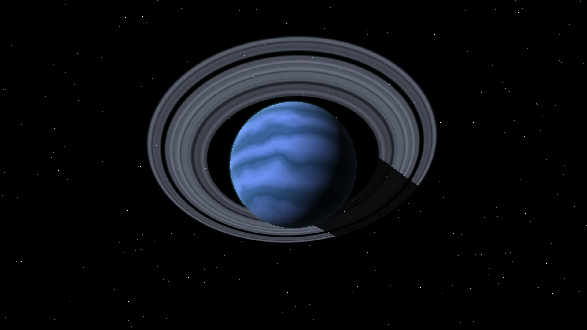
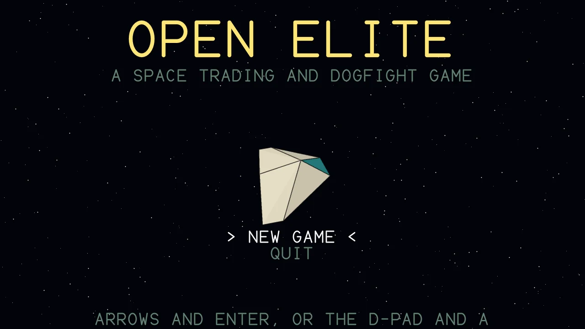
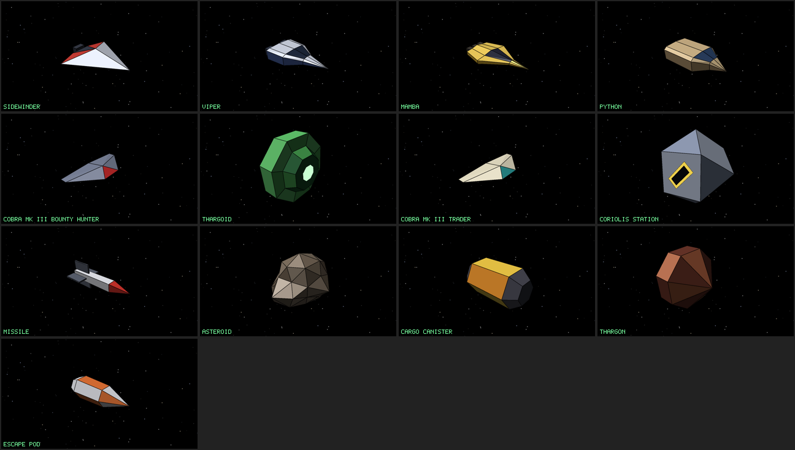

# Open Elite



The start of an open source version of the space trading game Elite: a **playable game**, a **game engine** and a
**ship rendering engine**, in C++17 with no dependencies beyond CMake (SDL2 for the window).

The engine plays the whole of the Elite loop: flight, laser and missile combat with AI pilots, traffic, stations and
docking, hyperspace between eight galaxies of 256 systems, markets and trading, equipment, legal status, combat rank and
saving. In front of it is a software rendered 3D cockpit, the screens of the station, sound and music, and a window with
keyboard and Xbox controller support.



## On this site

| | |
| --- | --- |
| [Playing](playing.md) | Screenshots of the game and how to fly it |
| [Ships](ships.md) | All 36 ships and objects, with their 3D models and numbers |
| [Stations](stations.md) | The Coriolis, the Dodo, the Wheel and the Rock hermit |
| [Upgrades](upgrades.md) | The equipment for sale, as 3D models |
| [Trade goods](trade-goods.md) | The 17 goods, as 3D models |
| [Worlds](planets.md) | Portraits of the planets, and the asteroid fields |



## Build and play

```bash
cmake -S . -B build
cmake --build build -j
ctest --test-dir build
./build/open_elite_game
```

## The models and the original game

Elite was written by Ian Bell and David Braben, and the game, its name and its data are theirs. **This project does not
contain any code, data or artwork from the original game.** The ship models are original geometry, drawn from a general
idea of each ship's role and shape, not from the original vertex tables.

Every picture on this site is drawn by the project itself. The pictures and these pages are made by `apps/site_gen`;
run `tools/make_site.sh` to make them again.
