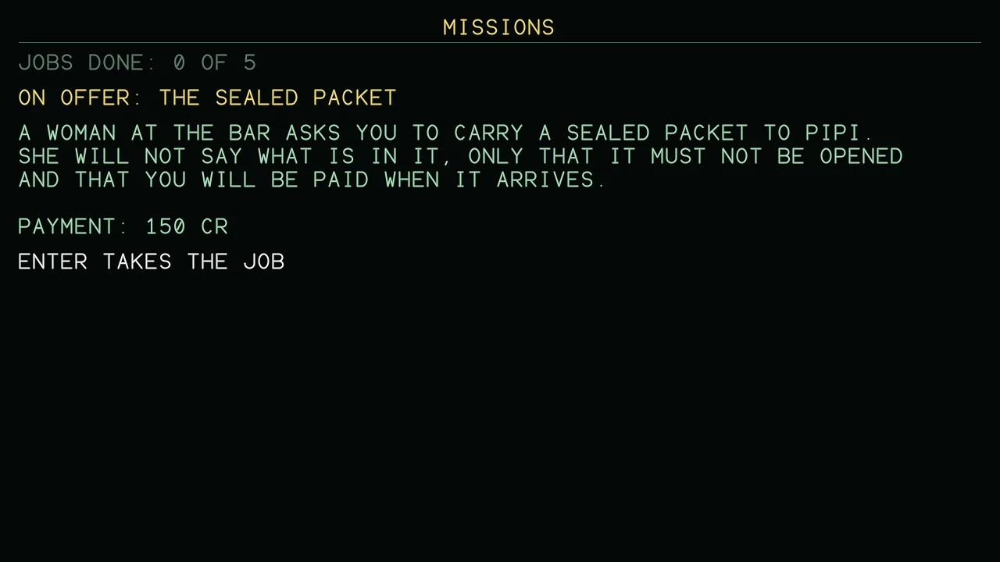

# Missions

The mission board in the station offers jobs one after another: a story of 5 steps. A job is on offer at any station once the one before is done, one at a time. Enter takes the job and Backspace gives it up; the job and the place in the story are saved with the commander. A delivery is paid when you dock at its destination. A hunt counts the pirates you shoot down (the bounties are yours as well) and is paid when you dock at any station.

{ loading=lazy }

The jobs are written for this game. The places in them depend on where you are when you take the job; the text below is what a pilot docked at the system of Lave is offered.

## 1. The Sealed Packet

A woman at the bar asks you to carry a sealed packet to Poka. She will not say what is in it, only that it must not be opened and that you will be paid when it arrives.

Payment: 150 Cr

When it is done: *The packet is taken without a word, and the payment is in your account.*

## 2. Clear The Lanes

Pirates have been taking traders on these routes. The station pays for the ones that stop: shoot down 3 pirate ships, then dock at any station to collect.

Payment: 400 Cr

When it is done: *The station pays out for the pirates you shot down.*

## 3. The Second Packet

The woman again. Someone is following her, and she has another packet for Poka. Take it, and mind your back.

Payment: 800 Cr

When it is done: *The woman's contact reads the packet twice and goes pale. She was right to be afraid.*

## 4. The Warlord's Fleet

The pirates are being organised. Their leader keeps out of sight, but his fleet can be broken: shoot down 8 pirate ships, then dock at any station.

Payment: 2000 Cr

When it is done: *With his fleet broken the warlord has gone to ground. The lanes are quiet again.*

## 5. Beyond The Rim

The packets held the plans of a galactic hyperdrive. Take them to Vesazasu, where an engineer will build one for you.

Payment: A Galactic Hyperdrive

When it is done: *The engineer fits a galactic hyperdrive to your ship. The next galaxy is one jump away: press J in flight.*

With the five jobs done the woman at the bar has no more work for you. The galactic hyperdrive is fitted and the next galaxy is one jump away (J in flight), with its own 256 systems to trade in.
