# Worlds

The galaxies are made from a number: eight galaxies of 256 systems, each with a government, an economy, a tech level, a population, a species and a planet. The planet in the cockpit is drawn from the system's seed, so it is always the same one: temperate, desert, frozen, ocean, volcanic, violet or toxic worlds, cratered moons, and gas giants, with continents, ice caps, an atmosphere that glows at the rim and, now and then, rings. These are portraits of a selection from the first galaxy, one of each kind, as the game draws them.

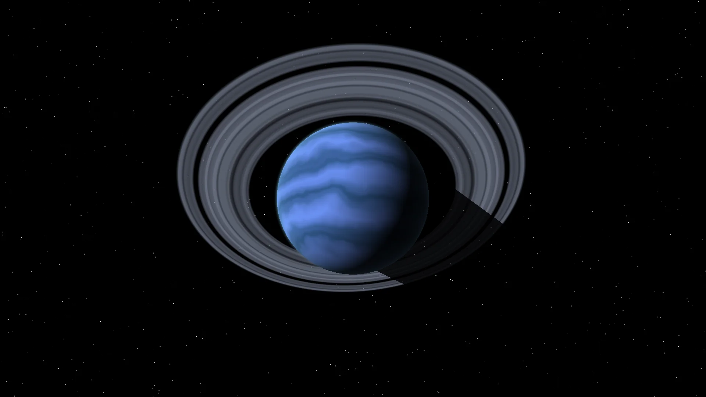

### Mikota

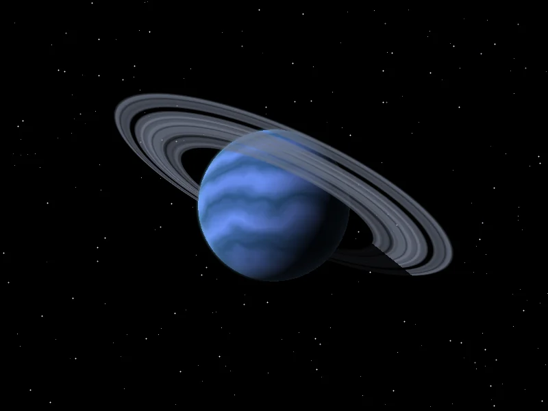{ loading=lazy }

| | | | |
| --- | --- | --- | --- |
| **Planet** | Blue gas giant, ringed | **Radius** | 5,366 km |
| **Government** | Dictatorship | **Economy** | Mainly Agricultural |
| **Tech level** | 8 | **Population** | 3.6 billion |
| **Productivity** | 12,096 M Cr | **Species** | Humanoids |
| **Station** | DODO STATION | **On the chart** | 244, 79 |

### Zano

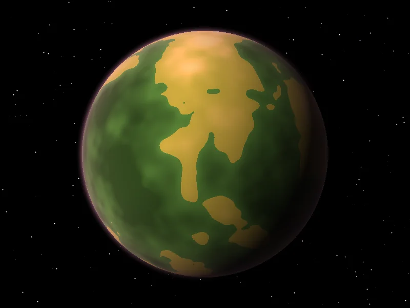{ loading=lazy }

| | | | |
| --- | --- | --- | --- |
| **Planet** | Toxic world | **Radius** | 5,738 km |
| **Government** | Communist | **Economy** | Mainly Industrial |
| **Tech level** | 7 | **Population** | 3.2 billion |
| **Productivity** | 14,336 M Cr | **Species** | Human Colonials |
| **Station** | DODO STATION | **On the chart** | 82, 47 |

### Wahota

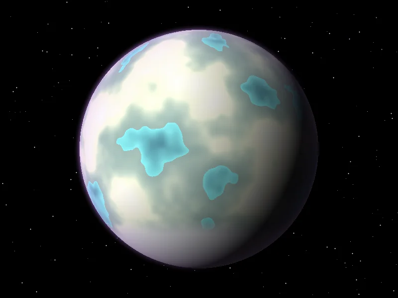{ loading=lazy }

| | | | |
| --- | --- | --- | --- |
| **Planet** | Frozen world | **Radius** | 4,808 km |
| **Government** | Multi-government | **Economy** | Mainly Agricultural |
| **Tech level** | 5 | **Population** | 2.3 billion |
| **Productivity** | 6,624 M Cr | **Species** | Crimson Frogs |
| **Station** | CORIOLIS STATION | **On the chart** | 100, 33 |

### Bimirasa

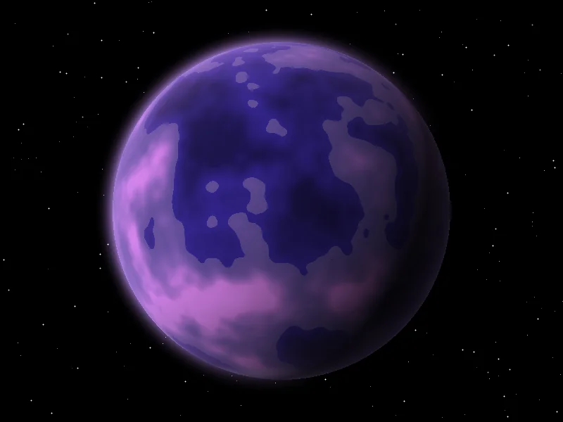{ loading=lazy }

| | | | |
| --- | --- | --- | --- |
| **Planet** | Violet jungle | **Radius** | 4,660 km |
| **Government** | Corporate State | **Economy** | Rich Industrial |
| **Tech level** | 12 | **Population** | 5.2 billion |
| **Productivity** | 45,760 M Cr | **Species** | Tall Silver Insects |
| **Station** | WHEEL STATION | **On the chart** | 7, 75 |

### Taxe

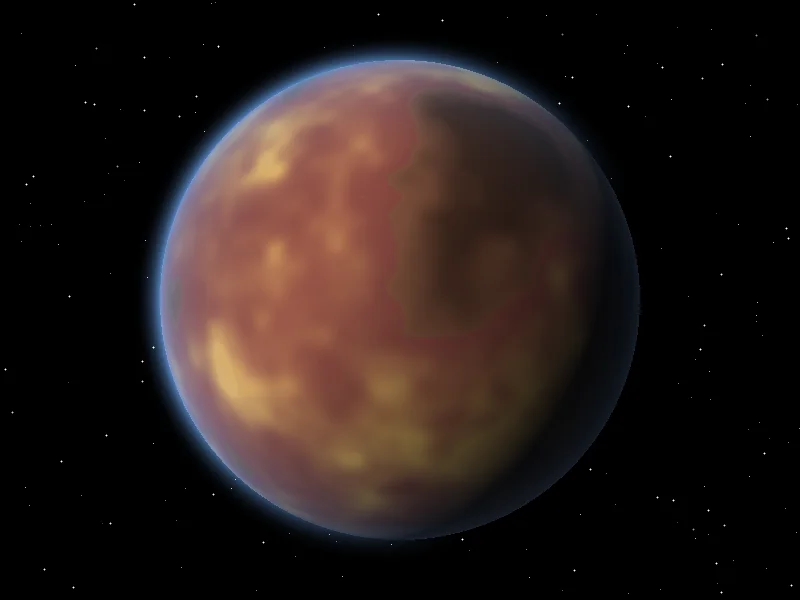{ loading=lazy }

| | | | |
| --- | --- | --- | --- |
| **Planet** | Rust world | **Radius** | 3,683 km |
| **Government** | Feudal | **Economy** | Poor Industrial |
| **Tech level** | 8 | **Population** | 3.2 billion |
| **Productivity** | 10,240 M Cr | **Species** | Lanky Felines |
| **Station** | CORIOLIS STATION | **On the chart** | 242, 89 |

### Mabeza

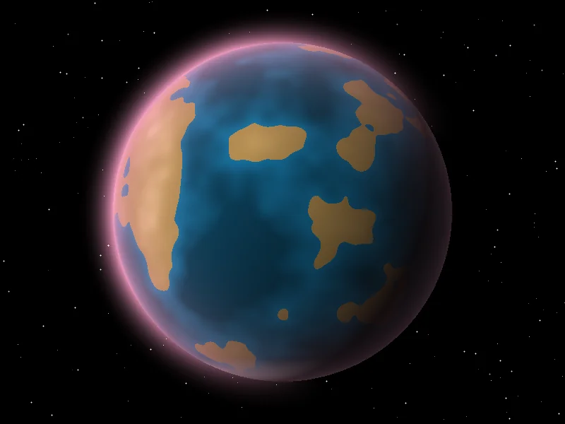{ loading=lazy }

| | | | |
| --- | --- | --- | --- |
| **Planet** | Teal seas | **Radius** | 4,264 km |
| **Government** | Communist | **Economy** | Average Agricultural |
| **Tech level** | 4 | **Population** | 2.3 billion |
| **Productivity** | 5,888 M Cr | **Species** | Tall Crimson Birds |
| **Station** | DODO STATION | **On the chart** | 31, 34 |

### Lasono

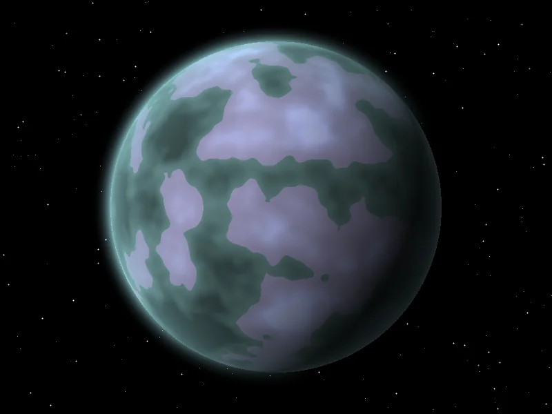{ loading=lazy }

| | | | |
| --- | --- | --- | --- |
| **Planet** | Cratered moon | **Radius** | 3,776 km |
| **Government** | Corporate State | **Economy** | Rich Industrial |
| **Tech level** | 12 | **Population** | 5.2 billion |
| **Productivity** | 45,760 M Cr | **Species** | Crabs |
| **Station** | WHEEL STATION | **On the chart** | 186, 82 |

### Lave

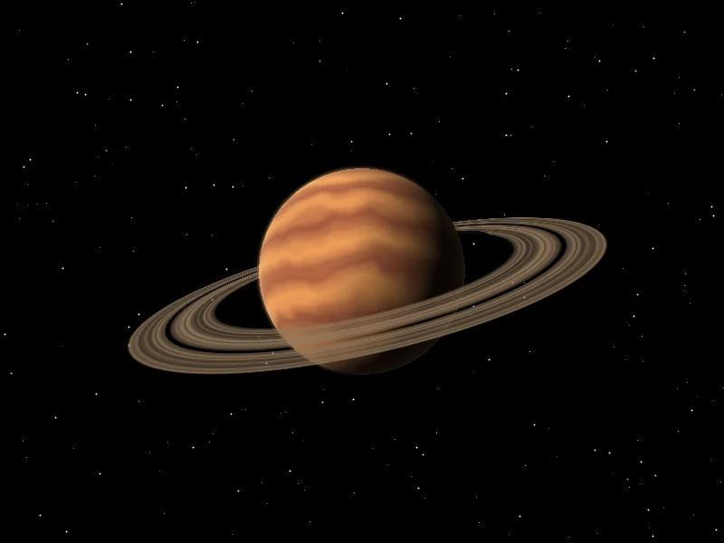{ loading=lazy }

| | | | |
| --- | --- | --- | --- |
| **Planet** | Amber gas giant, ringed | **Radius** | 5,117 km |
| **Government** | Communist | **Economy** | Mainly Agricultural |
| **Tech level** | 9 | **Population** | 4.1 billion |
| **Productivity** | 15,744 M Cr | **Species** | Human Colonials |
| **Station** | DODO STATION | **On the chart** | 174, 9 |

### Xeju

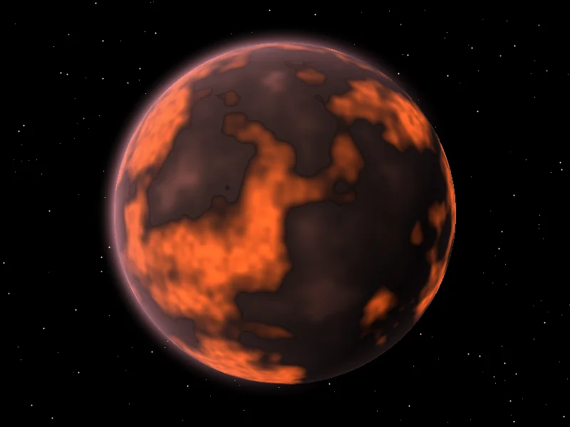{ loading=lazy }

| | | | |
| --- | --- | --- | --- |
| **Planet** | Volcanic world | **Radius** | 2,866 km |
| **Government** | Dictatorship | **Economy** | Poor Agricultural |
| **Tech level** | 5 | **Population** | 2.7 billion |
| **Productivity** | 4,536 M Cr | **Species** | Tall Frogs |
| **Station** | DODO STATION | **On the chart** | 203, 21 |

### Rumimi

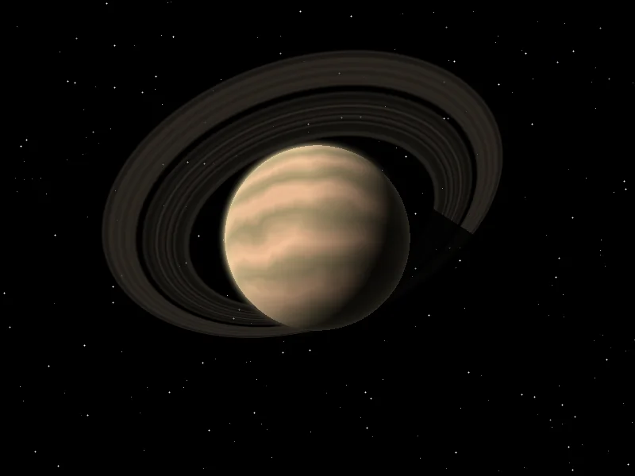{ loading=lazy }

| | | | |
| --- | --- | --- | --- |
| **Planet** | Cream gas giant, ringed | **Radius** | 5,530 km |
| **Government** | Democracy | **Economy** | Average Industrial |
| **Tech level** | 11 | **Population** | 4.8 billion |
| **Productivity** | 34,560 M Cr | **Species** | Human Colonials |
| **Station** | CORIOLIS STATION | **On the chart** | 125, 96 |

### Powabiga

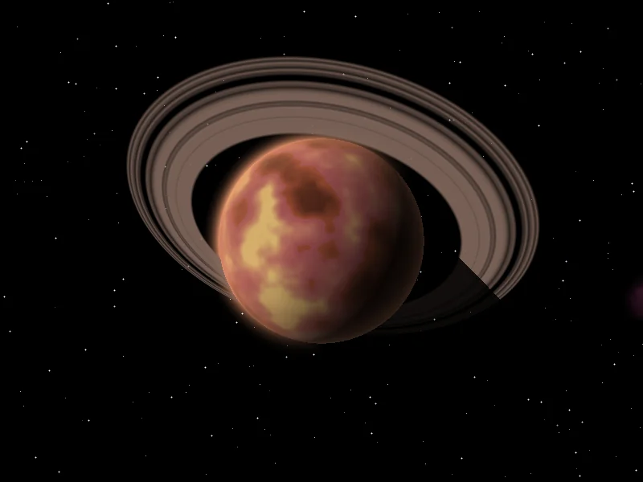{ loading=lazy }

| | | | |
| --- | --- | --- | --- |
| **Planet** | Rust world, ringed | **Radius** | 6,038 km |
| **Government** | Multi-government | **Economy** | Average Agricultural |
| **Tech level** | 3 | **Population** | 1.7 billion |
| **Productivity** | 3,264 M Cr | **Species** | Felines |
| **Station** | CORIOLIS STATION | **On the chart** | 234, 9 |

### Kako

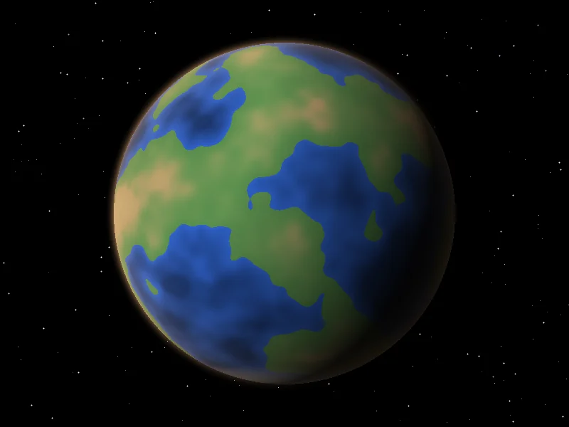{ loading=lazy }

| | | | |
| --- | --- | --- | --- |
| **Planet** | Temperate world | **Radius** | 4,393 km |
| **Government** | Corporate State | **Economy** | Poor Industrial |
| **Tech level** | 12 | **Population** | 5.4 billion |
| **Productivity** | 38,016 M Cr | **Species** | Slimy Felines |
| **Station** | CORIOLIS STATION | **On the chart** | 237, 67 |

### Matami

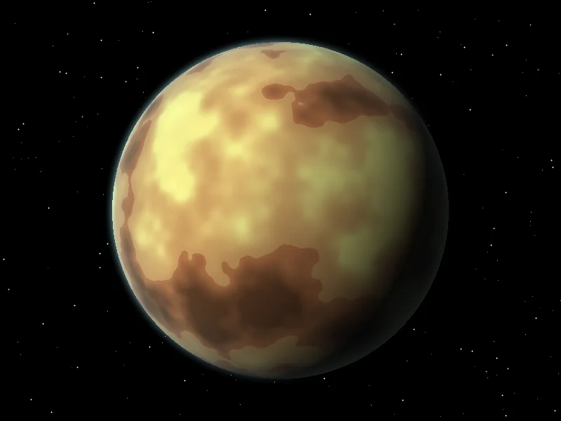{ loading=lazy }

| | | | |
| --- | --- | --- | --- |
| **Planet** | Desert world | **Radius** | 5,698 km |
| **Government** | Corporate State | **Economy** | Rich Industrial |
| **Tech level** | 15 | **Population** | 6.4 billion |
| **Productivity** | 56,320 M Cr | **Species** | Lanky Rodents |
| **Station** | CORIOLIS STATION | **On the chart** | 186, 77 |

### Cezafete

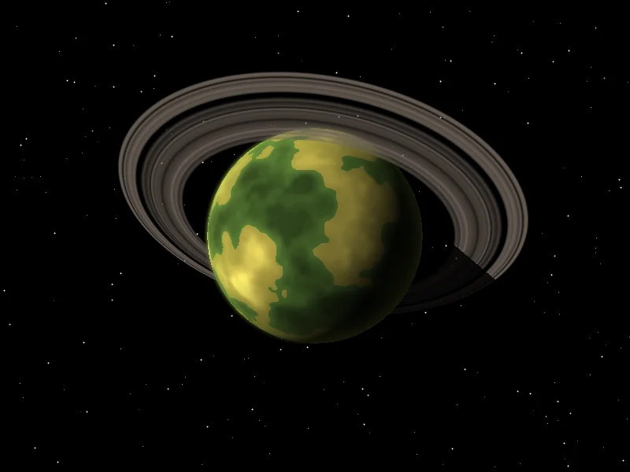{ loading=lazy }

| | | | |
| --- | --- | --- | --- |
| **Planet** | Toxic world, ringed | **Radius** | 4,140 km |
| **Government** | Feudal | **Economy** | Poor Industrial |
| **Tech level** | 10 | **Population** | 4 billion |
| **Productivity** | 12,800 M Cr | **Species** | Amber Felines |
| **Station** | WHEEL STATION | **On the chart** | 77, 3 |

### Tahopima

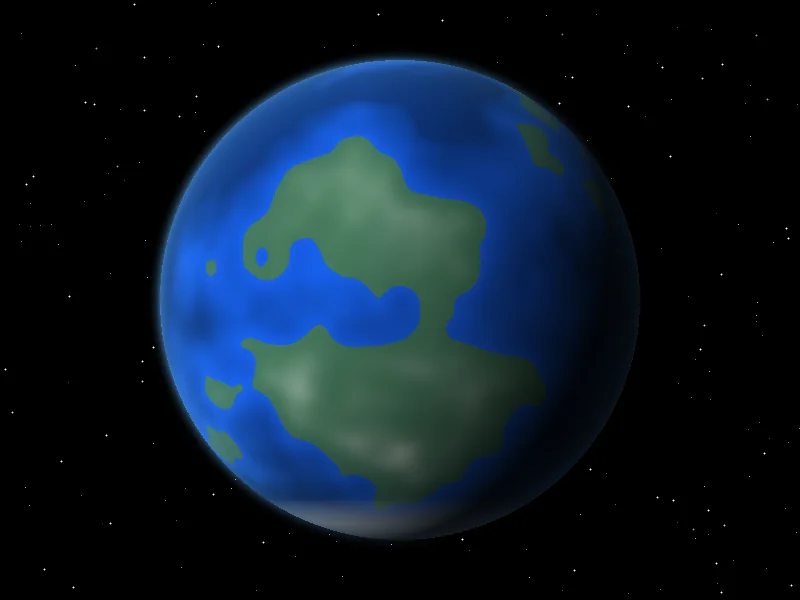{ loading=lazy }

| | | | |
| --- | --- | --- | --- |
| **Planet** | Ocean world | **Radius** | 4,000 km |
| **Government** | Confederacy | **Economy** | Average Industrial |
| **Tech level** | 11 | **Population** | 4.7 billion |
| **Productivity** | 30,456 M Cr | **Species** | Lanky Spiny Insects |
| **Station** | CORIOLIS STATION | **On the chart** | 54, 75 |

### Koonpo

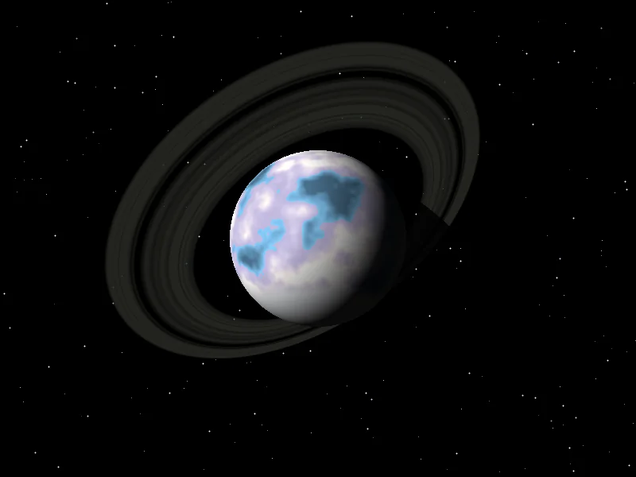{ loading=lazy }

| | | | |
| --- | --- | --- | --- |
| **Planet** | Frozen world, ringed | **Radius** | 6,805 km |
| **Government** | Dictatorship | **Economy** | Mainly Industrial |
| **Tech level** | 10 | **Population** | 4.3 billion |
| **Productivity** | 16,856 M Cr | **Species** | Lanky Scaled Lizards |
| **Station** | DODO STATION | **On the chart** | 215, 79 |

### Qucegaso

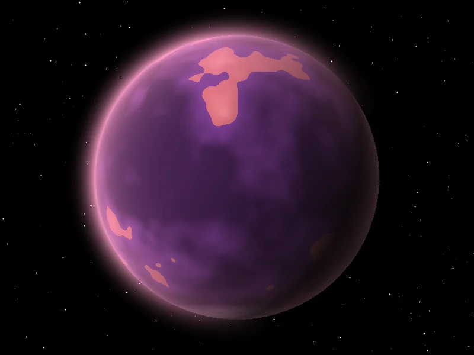{ loading=lazy }

| | | | |
| --- | --- | --- | --- |
| **Planet** | Coral world | **Radius** | 3,292 km |
| **Government** | Multi-government | **Economy** | Average Industrial |
| **Tech level** | 10 | **Population** | 4 billion |
| **Productivity** | 17,280 M Cr | **Species** | Silver Felines |
| **Station** | DODO STATION | **On the chart** | 139, 17 |

### Lydo

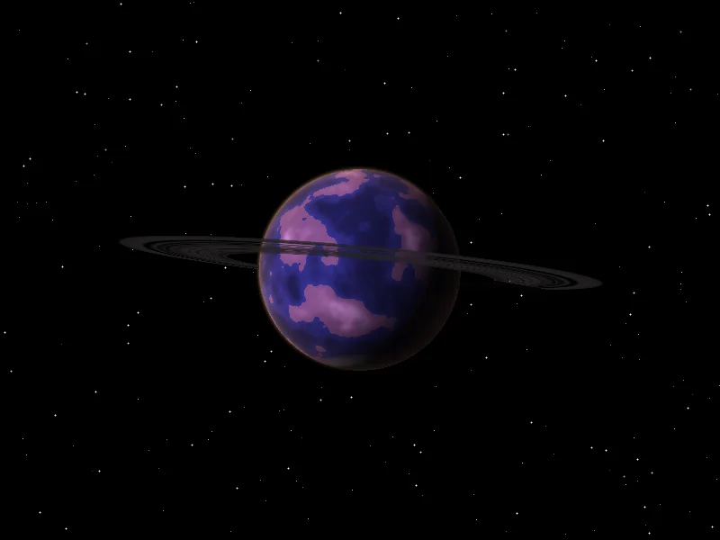{ loading=lazy }

| | | | |
| --- | --- | --- | --- |
| **Planet** | Violet jungle, ringed | **Radius** | 6,485 km |
| **Government** | Anarchy | **Economy** | Mainly Industrial |
| **Tech level** | 8 | **Population** | 3.2 billion |
| **Productivity** | 7,168 M Cr | **Species** | Human Colonials |
| **Station** | WHEEL STATION | **On the chart** | 81, 55 |

### Mirear

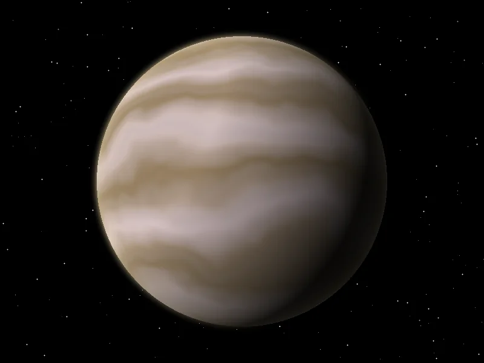{ loading=lazy }

| | | | |
| --- | --- | --- | --- |
| **Planet** | Cream gas giant | **Radius** | 3,463 km |
| **Government** | Democracy | **Economy** | Poor Industrial |
| **Tech level** | 12 | **Population** | 5.3 billion |
| **Productivity** | 33,920 M Cr | **Species** | Lanky Furred Lizards |
| **Station** | CORIOLIS STATION | **On the chart** | 16, 26 |

### Tesomi

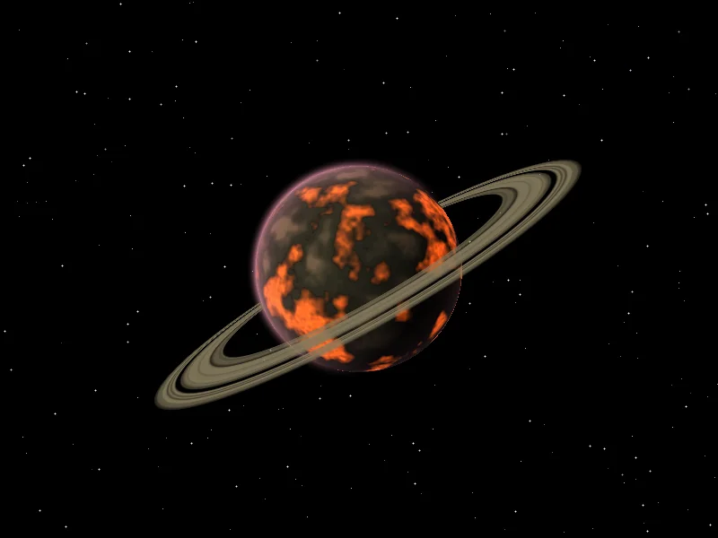{ loading=lazy }

| | | | |
| --- | --- | --- | --- |
| **Planet** | Volcanic world, ringed | **Radius** | 6,682 km |
| **Government** | Corporate State | **Economy** | Average Industrial |
| **Tech level** | 12 | **Population** | 5.3 billion |
| **Productivity** | 41,976 M Cr | **Species** | Lanky Green Lizards |
| **Station** | DODO STATION | **On the chart** | 11, 90 |

### Qusabira

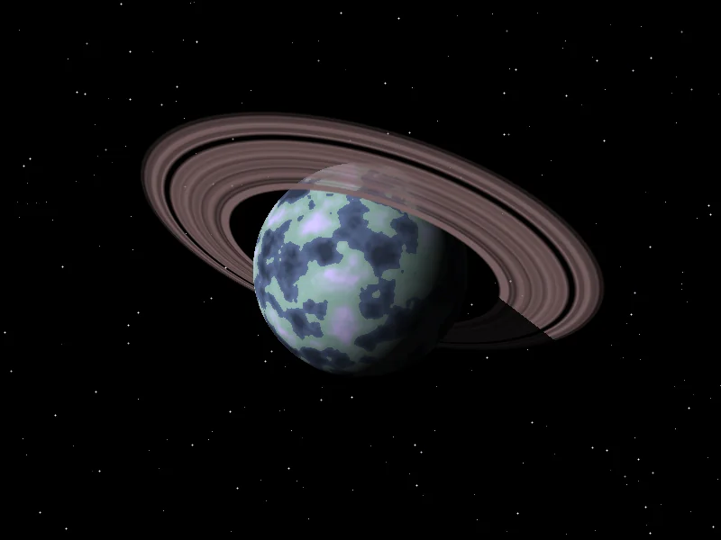{ loading=lazy }

| | | | |
| --- | --- | --- | --- |
| **Planet** | Cratered moon, ringed | **Radius** | 4,839 km |
| **Government** | Feudal | **Economy** | Poor Agricultural |
| **Tech level** | 4 | **Population** | 2.1 billion |
| **Productivity** | 2,520 M Cr | **Species** | Squat Violet Birds |
| **Station** | CORIOLIS STATION | **On the chart** | 60, 88 |

### Pipi

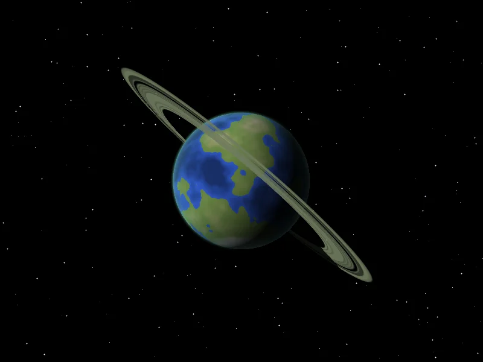{ loading=lazy }

| | | | |
| --- | --- | --- | --- |
| **Planet** | Temperate world, ringed | **Radius** | 3,938 km |
| **Government** | Anarchy | **Economy** | Mainly Industrial |
| **Tech level** | 5 | **Population** | 2 billion |
| **Productivity** | 4,480 M Cr | **Species** | Tall Horned Frogs |
| **Station** | WHEEL STATION | **On the chart** | 93, 91 |

### Juce

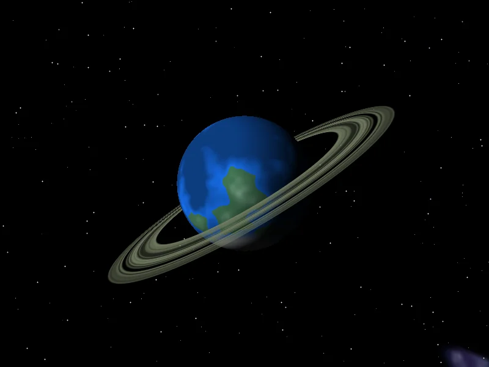{ loading=lazy }

| | | | |
| --- | --- | --- | --- |
| **Planet** | Ocean world, ringed | **Radius** | 3,756 km |
| **Government** | Feudal | **Economy** | Average Agricultural |
| **Tech level** | 5 | **Population** | 2.4 billion |
| **Productivity** | 3,840 M Cr | **Species** | Lanky Pale Furred Rodents |
| **Station** | CORIOLIS STATION | **On the chart** | 228, 27 |

### Ruar

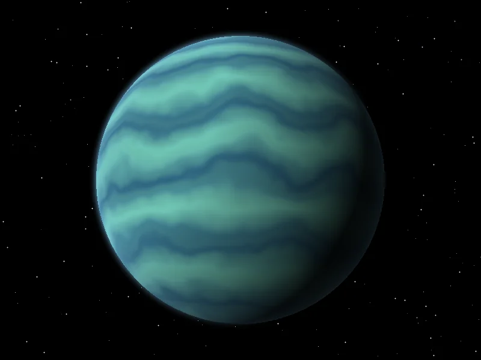{ loading=lazy }

| | | | |
| --- | --- | --- | --- |
| **Planet** | Blue gas giant | **Radius** | 6,037 km |
| **Government** | Democracy | **Economy** | Rich Agricultural |
| **Tech level** | 7 | **Population** | 3.6 billion |
| **Productivity** | 14,400 M Cr | **Species** | Tall Spiny Birds |
| **Station** | DODO STATION | **On the chart** | 174, 119 |

### Lukogako

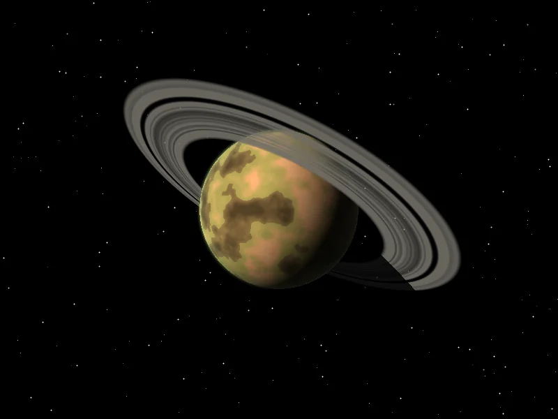{ loading=lazy }

| | | | |
| --- | --- | --- | --- |
| **Planet** | Desert world, ringed | **Radius** | 5,927 km |
| **Government** | Anarchy | **Economy** | Poor Agricultural |
| **Tech level** | 3 | **Population** | 1.6 billion |
| **Productivity** | 1,536 M Cr | **Species** | Squat Humanoids |
| **Station** | WHEEL STATION | **On the chart** | 61, 96 |

### Arce

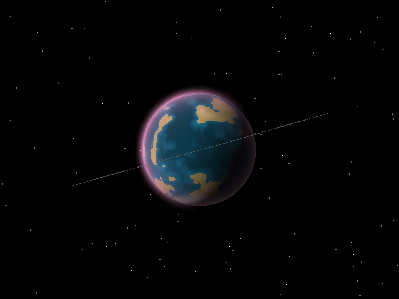{ loading=lazy }

| | | | |
| --- | --- | --- | --- |
| **Planet** | Teal seas, ringed | **Radius** | 5,829 km |
| **Government** | Communist | **Economy** | Average Industrial |
| **Tech level** | 9 | **Population** | 3.8 billion |
| **Productivity** | 21,888 M Cr | **Species** | Furred Crabs |
| **Station** | CORIOLIS STATION | **On the chart** | 97, 15 |

### Bebevila

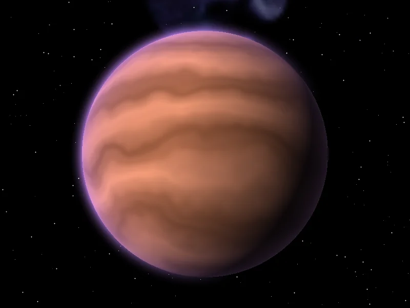{ loading=lazy }

| | | | |
| --- | --- | --- | --- |
| **Planet** | Amber gas giant | **Radius** | 5,624 km |
| **Government** | Democracy | **Economy** | Rich Industrial |
| **Tech level** | 11 | **Population** | 4.7 billion |
| **Productivity** | 37,600 M Cr | **Species** | Lanky Amber Lizards |
| **Station** | DODO STATION | **On the chart** | 225, 20 |

## Asteroid fields

Each system has its own asteroid field, the same every visit: rocks from splinters of 8 metres to giants of nearly a kilometre, split 20 sided shapes pushed in and out by lumps, craters and bumps, in rocky, metallic, icy or dark colours. A row for each size class:

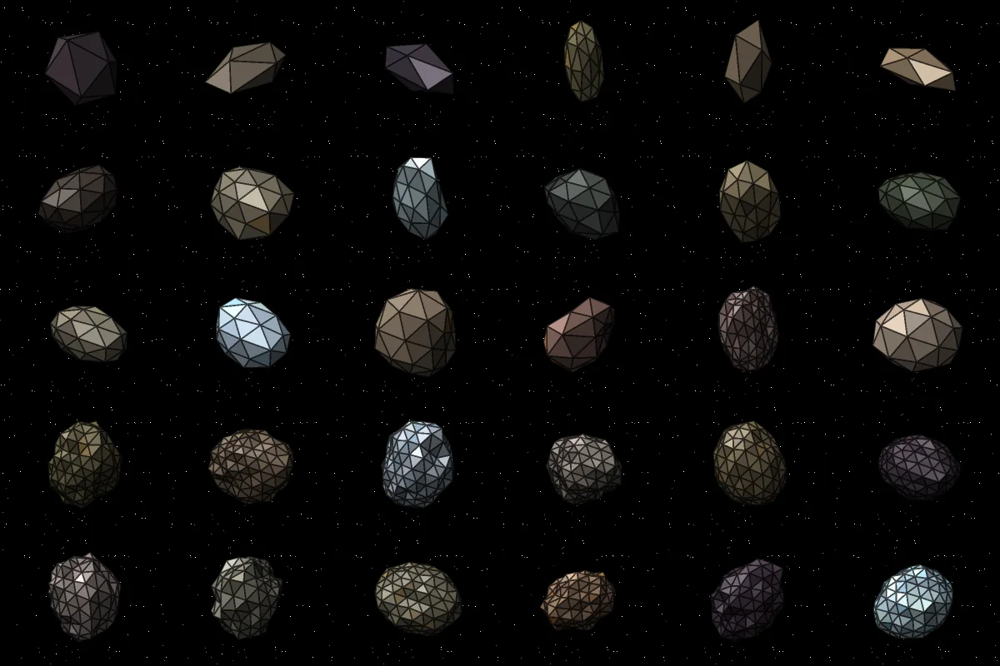{ loading=lazy }
