# Playing

The game is drawn by a software renderer: a clear view out of the ship over the top four fifths, and a 3D console of
computer screens along the bottom fifth, painted in the colours of the player's own ship. All the pictures here come
from the game itself.

## In flight

A dogfight with pirates: target brackets, laser bolts and the scanner in the console.

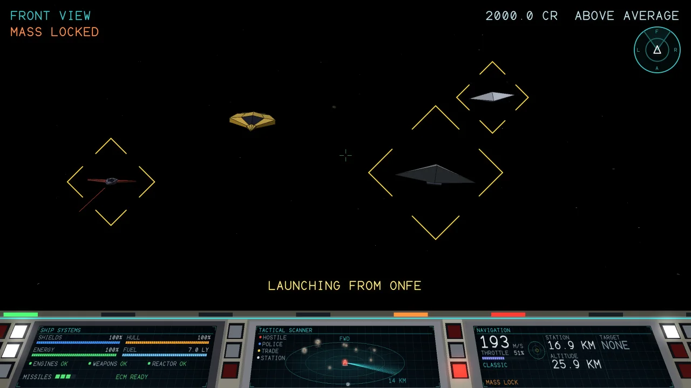{ loading=lazy }

A heavy Python and a Cobra Mk III in pirate paint, with a Viper of the police arriving.

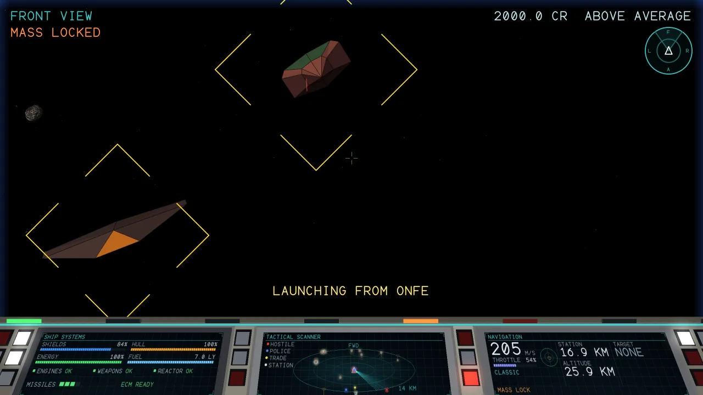{ loading=lazy }

A Thargoid alien mothership and its Thargon drones.

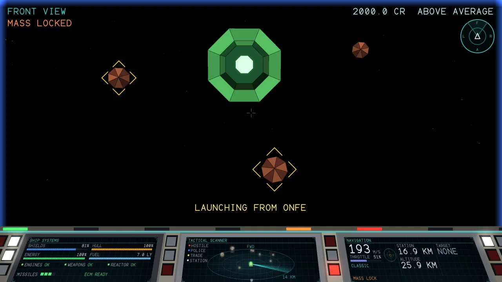{ loading=lazy }

The elite hunters, the Constrictor and the Cougar.

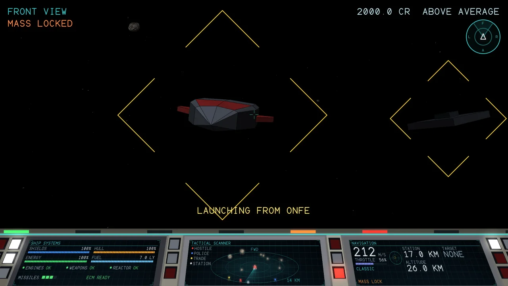{ loading=lazy }

Each system has its own asteroid field.

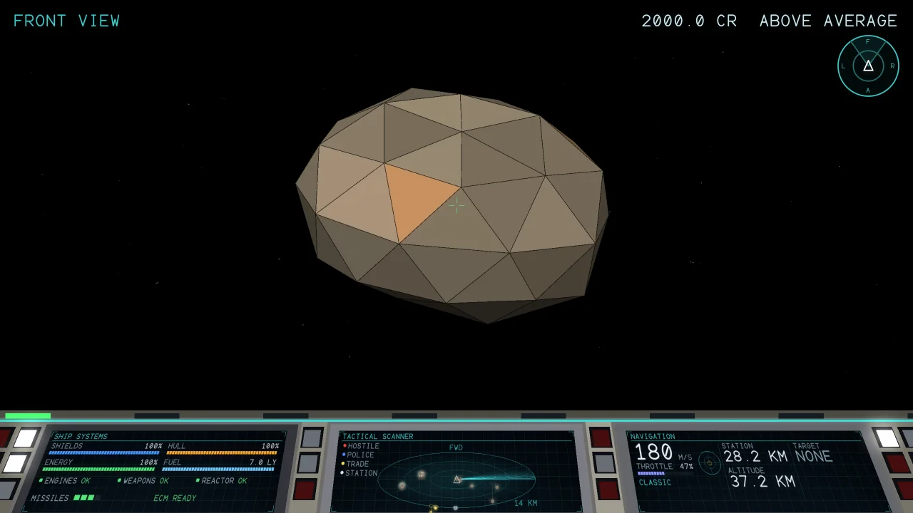{ loading=lazy }

## Stations

Every system has a station. The station of a system is always the same one.

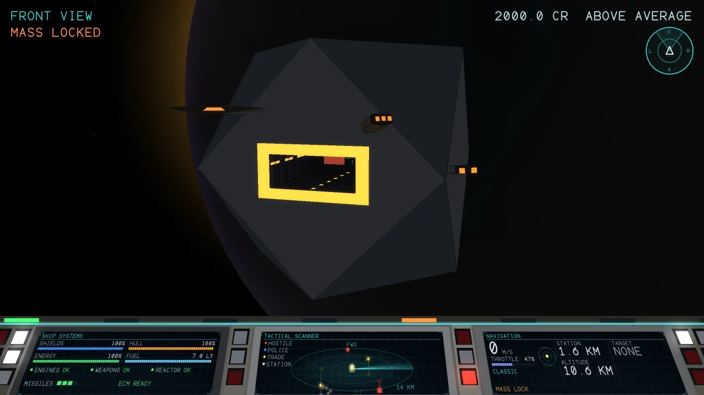{ loading=lazy }

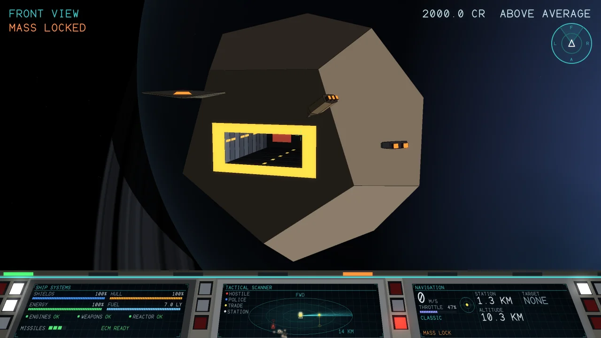{ loading=lazy }

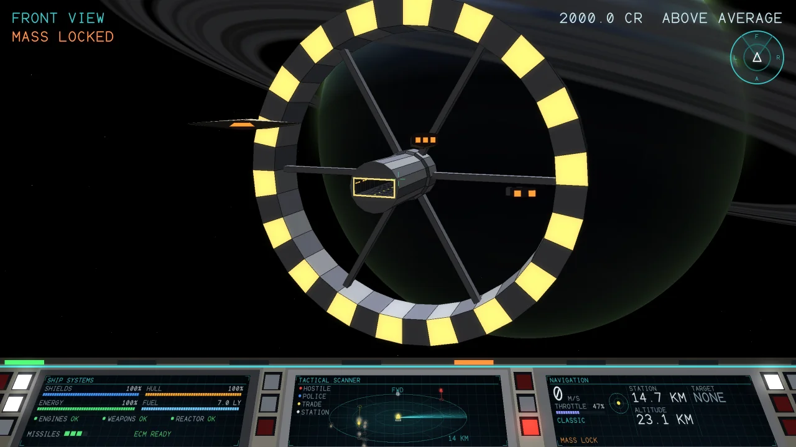{ loading=lazy }

Launching rides the ship out of the docking bay, with the controls locked for a few seconds.

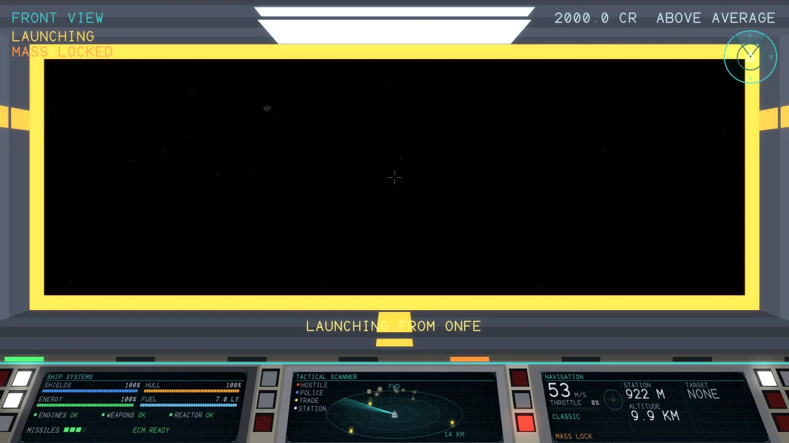{ loading=lazy }

Docking is the same in reverse: a tractor beam takes the ship at the mouth of the bay, draws it in and sets it down on
the floor. Switch on a docking computer with K and it flies the ship in for you.

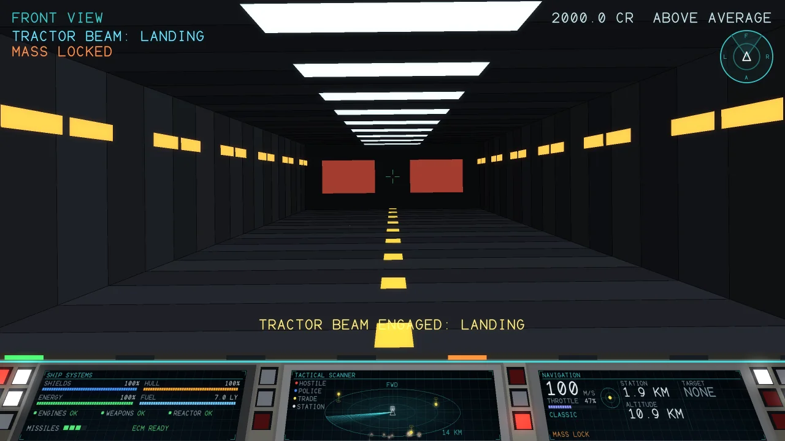{ loading=lazy }

## The station screens

Once docked, the screens of the station come up: status, market, equipment, shipyard, the galactic chart and the data on a system.
Tab changes screen, the arrows and Enter choose and buy, Backspace sells, and L launches.

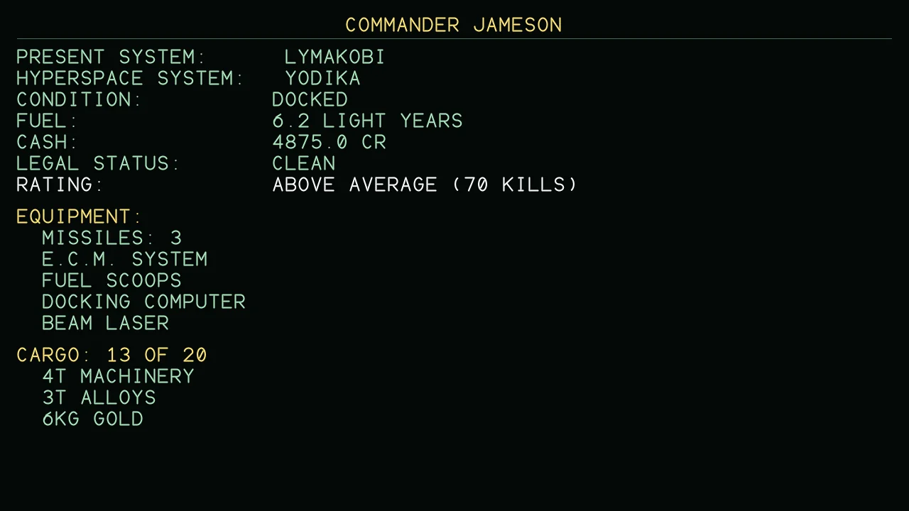{ loading=lazy }

The market draws the highlighted good in 3D beside the list.

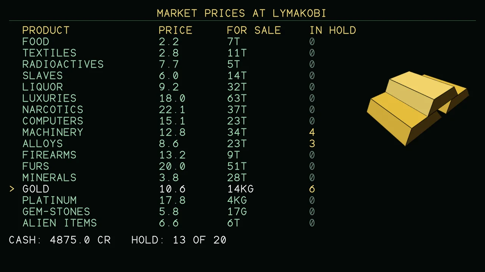{ loading=lazy }

The equipment screen draws the highlighted item under the list.

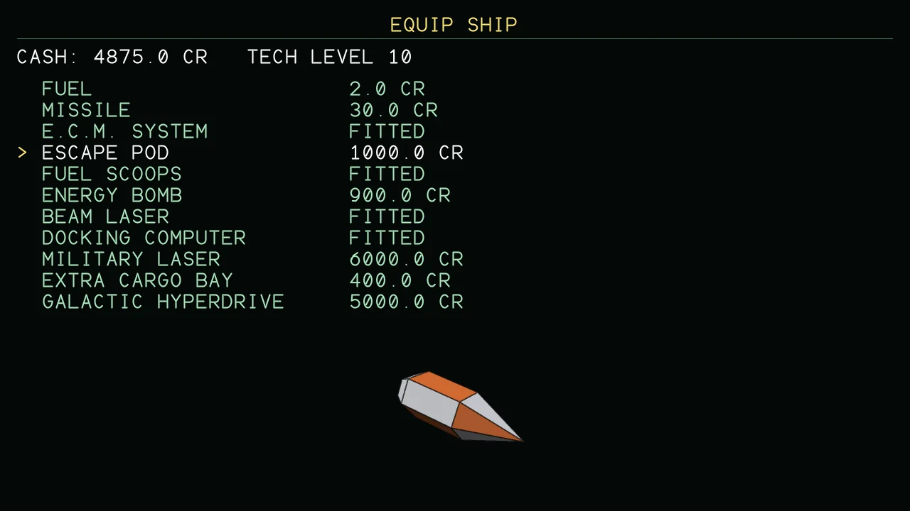{ loading=lazy }

The shipyard sells other ships. You pay the price less what the yard gives for your own ship; your equipment and
missiles go across to the new one, and the hold has to be big enough for the cargo you carry. The better ships need a
high tech level.

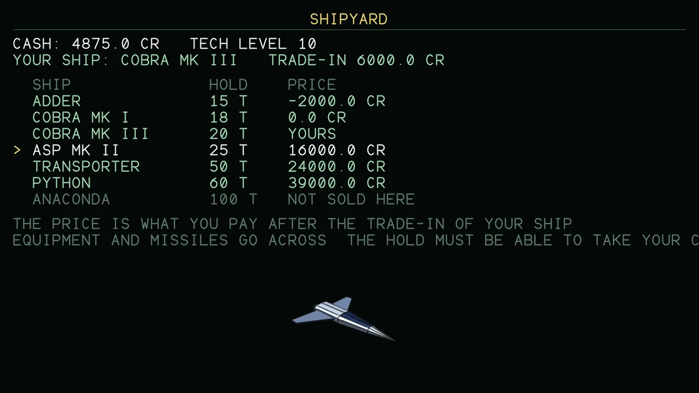{ loading=lazy }

The mission board offers jobs one after another, a story of five steps: carry a sealed packet to a nearby system, shoot
down pirates, carry a second packet, break the pirate fleet, and carry the plans of a galactic hyperdrive to the engineer
who will build one for you. Enter takes the job and Backspace gives it up. A delivery is paid when you dock at its
destination, and a hunt when you dock at any station after shooting down enough pirates.

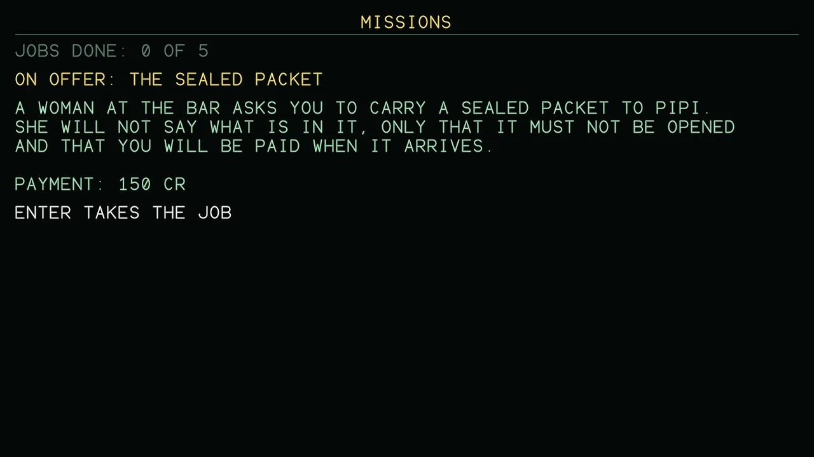{ loading=lazy }

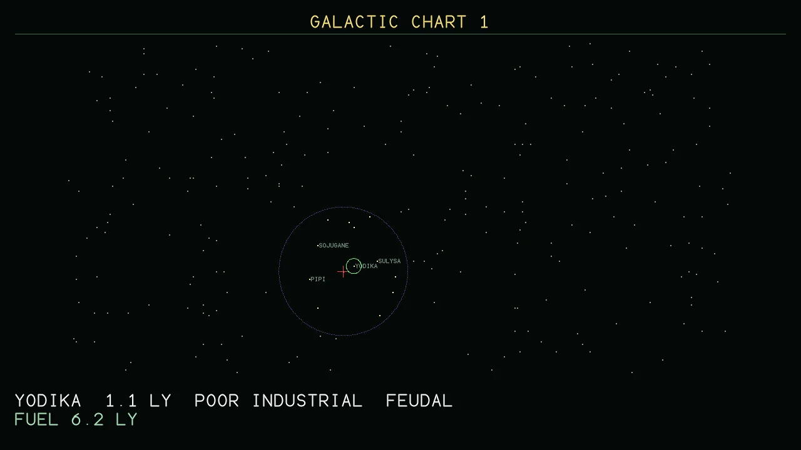{ loading=lazy }

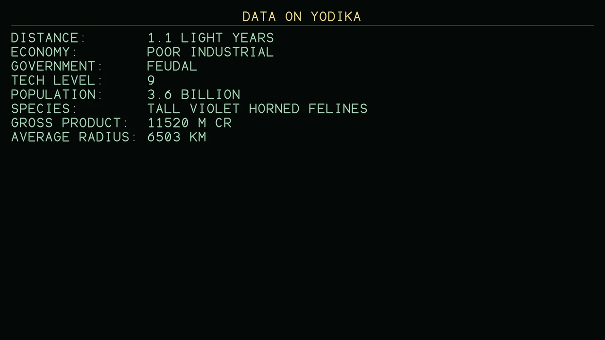{ loading=lazy }

## Controls

| Keys in flight | |
| --- | --- |
| Arrows | Pitch (down is nose up) and roll |
| Q / E | Roll left and right |
| A / D | Yaw left and right |
| W / S | Throttle up and down |
| X / Z | Throttle straight to full / straight to nothing |
| Hold Shift | Fine control, for lining up a shot |
| Space | Fire lasers |
| T / M | Lock a missile on the target / fire it |
| Tab / Shift+Tab | Next and previous target |
| C / B | ECM / energy bomb |
| H | Hyperspace (choose a system on the chart with G first) |
| J | Galactic hyperdrive: jump to the next galaxy (uses up the drive, no fuel) |
| K / Y / N | Docking computer / flight assist / classic or Newtonian flight |
| 1 2 3 4 | Front, rear, left and right views |
| G | Galactic chart |
| P or Esc | Pause menu |
| F1 | The list of keys, in the game |
| Hold Backspace | Eject in the escape pod |

Xbox 360, Xbox One and Xbox Elite controllers work too: the left stick pitches and rolls, the right stick yaws and sets
the throttle, RT fires the lasers and LT the missile.
