# Ships

Every ship of the game, drawn by the game's own software renderer from two sides. The first 13 are the ships of the original cassette ship list, in its order, and the rest are the further ships of the later versions; the Cobra Mk III and Python each have a pirate paint job on the same model. The models are original work, not taken from any version of Elite. The numbers are the game's own: speeds in metres a second, turn rates in radians a second, and hull, shield and energy in points of damage. The stations are on [their own page](stations.md).

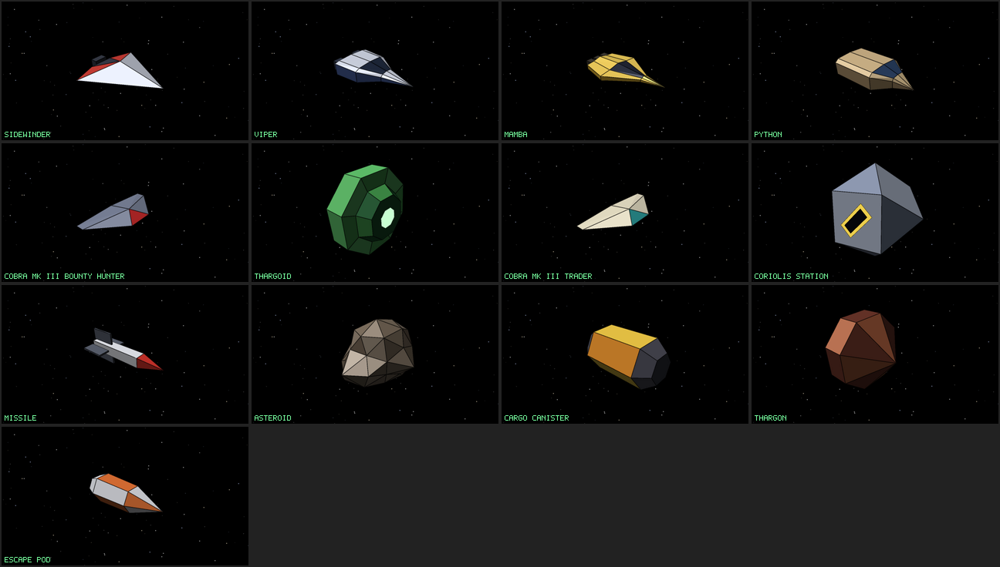

## At a glance

| Ship | Length | Top speed | Hull | Shield | Lasers | Missiles | Bounty | Flown as |
| --- | --- | --- | --- | --- | --- | --- | --- | --- |
| [Sidewinder](#sidewinder) | 32.61 m | 450 m/s | 70 | 40 | 1 | 0 | 50 Cr | Light pirate |
| [Viper](#viper) | 41.23 m | 420 m/s | 120 | 80 | 2 | 1 |  | Police |
| [Mamba](#mamba) | 39.92 m | 500 m/s | 90 | 70 | 2 | 2 | 150 Cr | Pirate |
| [Python](#python) | 90.04 m | 250 m/s | 400 | 250 | 2 | 3 | 200 Cr | Armed trader |
| [Cobra Mk III (bounty hunter)](#cobra-mk-iii-bounty-hunter) | 22.85 m | 400 m/s | 200 | 150 | 2 | 2 | 120 Cr | Bounty hunter |
| [Thargoid](#thargoid) | 37.75 m | 300 m/s | 450 | 300 | 2 | 6 | 500 Cr | Alien mothership |
| [Cobra Mk III (trader)](#cobra-mk-iii-trader) | 22.85 m | 380 m/s | 160 | 100 | 1 | 0 |  | Trader |
| [Thargon](#thargon) | 5.58 m | 480 m/s | 30 | 0 | 1 | 0 | 20 Cr | Alien drone |
| [Shuttle](#shuttle) | 39.95 m | 300 m/s | 80 | 40 | 0 | 0 |  | Trader |
| [Transporter](#transporter) | 74.69 m | 220 m/s | 220 | 120 | 1 | 0 |  | Trader |
| [Boa](#boa) | 81.21 m | 260 m/s | 380 | 220 | 2 | 2 | 250 Cr | Heavy pirate |
| [Anaconda](#anaconda) | 125.51 m | 230 m/s | 520 | 350 | 2 | 2 | 350 Cr | Armed trader |
| [Cobra Mk I](#cobra-mk-i) | 38.37 m | 340 m/s | 110 | 60 | 1 | 1 | 80 Cr | Light pirate |
| [Adder](#adder) | 40.04 m | 360 m/s | 100 | 60 | 1 | 0 | 70 Cr | Armed trader |
| [Krait](#krait) | 33.65 m | 480 m/s | 85 | 60 | 1 | 0 | 100 Cr | Light pirate |
| [Gecko](#gecko) | 29.41 m | 460 m/s | 65 | 40 | 1 | 0 | 55 Cr | Light pirate |
| [Worm](#worm) | 28.16 m | 420 m/s | 60 | 30 | 1 | 0 | 40 Cr | Alien drone |
| [Asp Mk II](#asp-mk-ii) | 41.61 m | 520 m/s | 150 | 120 | 2 | 2 | 200 Cr | Bounty hunter |
| [Fer-de-lance](#fer-de-lance) | 48.06 m | 480 m/s | 190 | 150 | 2 | 2 | 250 Cr | Pirate |
| [Moray](#moray) | 38.54 m | 360 m/s | 130 | 80 | 1 | 1 | 100 Cr | Armed trader |
| [Constrictor](#constrictor) | 52.5 m | 560 m/s | 450 | 350 | 2 | 4 | 600 Cr | Elite hunter |
| [Cougar](#cougar) | 51.76 m | 540 m/s | 380 | 300 | 2 | 4 | 550 Cr | Elite hunter |
| [Cobra Mk III (pirate)](#cobra-mk-iii-pirate) | 22.85 m | 400 m/s | 150 | 100 | 2 | 1 | 175 Cr | Pirate |
| [Python (pirate)](#python-pirate) | 90.04 m | 250 m/s | 400 | 250 | 2 | 3 | 300 Cr | Heavy pirate |

## Ships

### Sidewinder

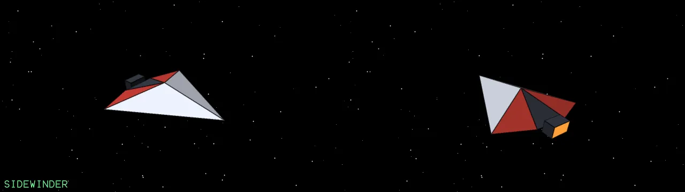{ loading=lazy }

A small kite-shaped fighter, quick and cheap. Pirates fly it in packs and rely on numbers.

| | | | |
| --- | --- | --- | --- |
| **Size** | 32.61 × 28.99 × 6.64 m | **Mass** | 9 t |
| **Top speed** | 450 m/s | **Acceleration** | 90 m/s² |
| **Pitch, roll, yaw** | 1.8, 2.6, 0.9 rad/s | **Hull** | 70 |
| **Shield** | 40 | **Energy** | 60 (+4/s) |
| **Lasers** | 1 | **Engines** | 1 |
| **Bounty** | 50 Cr | **Combat points** | 0.33 |
| **Flown as** | Light pirate | **Can be shot out** | engines, weapons, reactor |

### Viper

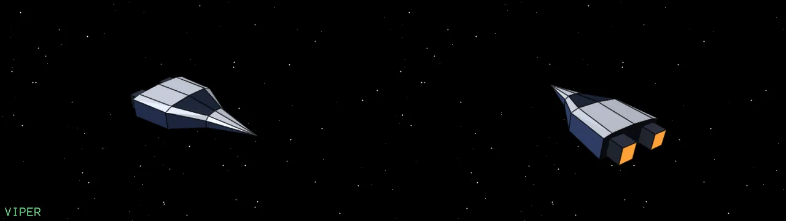{ loading=lazy }

The police interceptor: two lasers, two engines and a missile. It patrols the system and hunts offenders and fugitives, and comes in pairs for a wanted pilot.

| | | | |
| --- | --- | --- | --- |
| **Size** | 41.23 × 20.62 × 8.14 m | **Mass** | 14 t |
| **Top speed** | 420 m/s | **Acceleration** | 80 m/s² |
| **Pitch, roll, yaw** | 1.6, 2.3, 0.8 rad/s | **Hull** | 120 |
| **Shield** | 80 | **Energy** | 100 (+6/s) |
| **Lasers** | 2 | **Missiles** | 1 |
| **Engines** | 2 | **Combat points** | 0.1 |
| **Flown as** | Police | **Can be shot out** | engines, weapons, reactor |

### Mamba

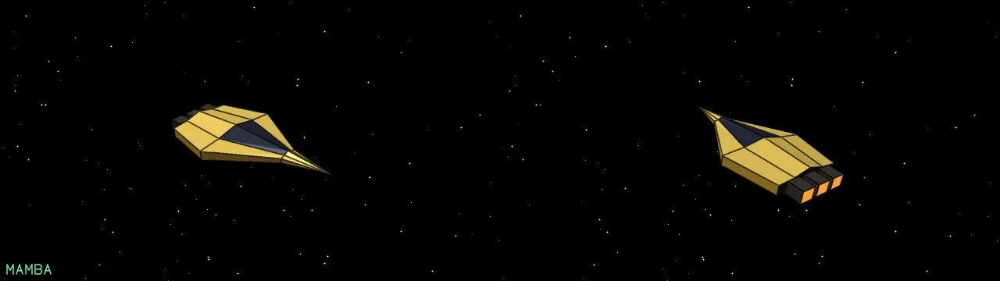{ loading=lazy }

Long, slim and fast, with three engines. A medium pirate that carries a missile and fights hard.

| | | | |
| --- | --- | --- | --- |
| **Size** | 39.92 × 20.74 × 5.18 m | **Mass** | 12 t |
| **Top speed** | 500 m/s | **Acceleration** | 100 m/s² |
| **Pitch, roll, yaw** | 1.7, 2.4, 0.8 rad/s | **Hull** | 90 |
| **Shield** | 70 | **Energy** | 90 (+5/s) |
| **Lasers** | 2 | **Missiles** | 2 |
| **Engines** | 3 | **Bounty** | 150 Cr |
| **Combat points** | 0.5 | **Drops up to** | 1 canisters |
| **Flown as** | Pirate | **Can be shot out** | engines, weapons, reactor |

### Python

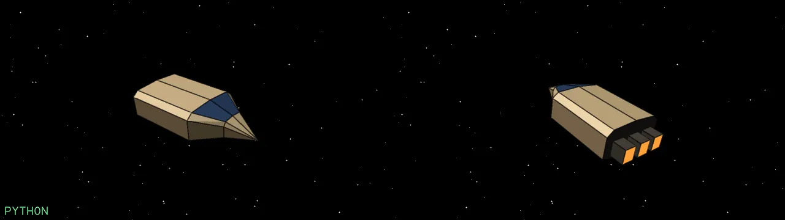{ loading=lazy }

A heavy freighter with a big hold and strong shields. Slow to turn, but armed with three missiles and two lasers.

| | | | |
| --- | --- | --- | --- |
| **Size** | 90.04 × 41.01 × 22.29 m | **Mass** | 90 t |
| **Top speed** | 250 m/s | **Acceleration** | 35 m/s² |
| **Pitch, roll, yaw** | 0.7, 1, 0.35 rad/s | **Hull** | 400 |
| **Shield** | 250 | **Energy** | 200 (+8/s) |
| **Lasers** | 2 | **Missiles** | 3 |
| **Engines** | 2 | **Bounty** | 200 Cr |
| **Combat points** | 0.66 | **Drops up to** | 5 canisters |
| **Flown as** | Armed trader | **Can be shot out** | engines, weapons, reactor |

### Cobra Mk III (bounty hunter)

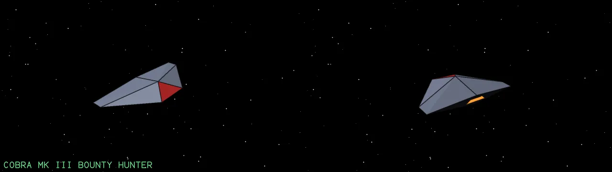{ loading=lazy }

Modelled from the proportions of a three view silhouette. Fitted out as a bounty hunter: it goes after pirates and wanted pilots, and has a fuel scoop.

| | | | |
| --- | --- | --- | --- |
| **Size** | 22.85 × 49.49 × 6.97 m | **Mass** | 20 t |
| **Top speed** | 400 m/s | **Acceleration** | 70 m/s² |
| **Pitch, roll, yaw** | 1.3, 2, 0.7 rad/s | **Hull** | 200 |
| **Shield** | 150 | **Energy** | 150 (+8/s) |
| **Lasers** | 2 | **Missiles** | 2 |
| **Engines** | 2 | **Fuel scoop** | yes |
| **Bounty** | 120 Cr | **Combat points** | 0.9 |
| **Drops up to** | 3 canisters | **Flown as** | Bounty hunter |
| **Can be shot out** | engines, weapons, reactor | | |

### Thargoid

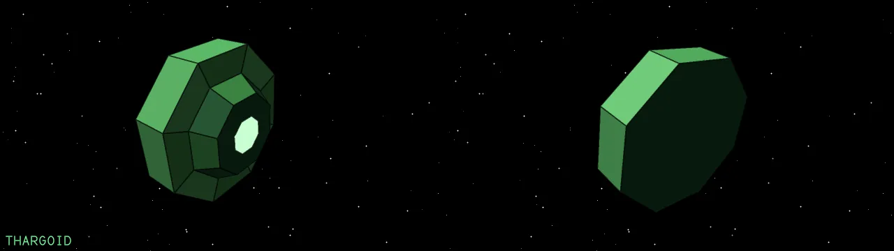{ loading=lazy }

The octagonal alien mothership. It launches swarms of Thargon drones and carries six missiles. Rare, and very dangerous.

| | | | |
| --- | --- | --- | --- |
| **Size** | 37.75 × 94.27 × 94.27 m | **Mass** | 80 t |
| **Top speed** | 300 m/s | **Acceleration** | 45 m/s² |
| **Pitch, roll, yaw** | 0.9, 0.9, 0.6 rad/s | **Hull** | 450 |
| **Shield** | 300 | **Energy** | 300 (+10/s) |
| **Lasers** | 2 | **Missiles** | 6 |
| **Bounty** | 500 Cr | **Combat points** | 2.6 |
| **Flown as** | Alien mothership | **Can be shot out** | weapons, reactor |

### Cobra Mk III (trader)

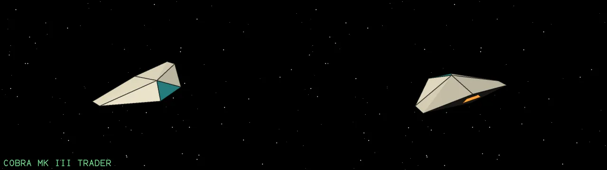{ loading=lazy }

The commander's own ship: the classic all-round trader with a fuel scoop, good manoeuvrability and a hold of 20 tonnes.

| | | | |
| --- | --- | --- | --- |
| **Size** | 22.85 × 49.49 × 6.97 m | **Mass** | 20 t |
| **Top speed** | 380 m/s | **Acceleration** | 65 m/s² |
| **Pitch, roll, yaw** | 1.2, 1.9, 0.7 rad/s | **Hull** | 160 |
| **Shield** | 100 | **Energy** | 100 (+6/s) |
| **Lasers** | 1 | **Engines** | 2 |
| **Fuel scoop** | yes | **Combat points** | 0.9 |
| **Drops up to** | 3 canisters | **Flown as** | Trader |
| **Can be shot out** | engines, weapons, reactor | | |

### Thargon

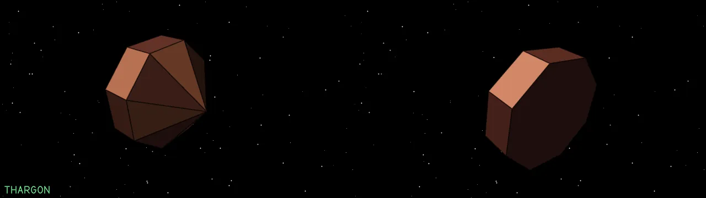{ loading=lazy }

A small drone launched by a Thargoid mothership. Tiny and fast, it swarms its target.

| | | | |
| --- | --- | --- | --- |
| **Size** | 5.58 × 7.93 × 7.93 m | **Mass** | 400 kg |
| **Top speed** | 480 m/s | **Acceleration** | 120 m/s² |
| **Pitch, roll, yaw** | 2.5, 3.2, 1.2 rad/s | **Hull** | 30 |
| **Energy** | 30 (+3/s) | **Lasers** | 1 |
| **Engines** | 1 | **Bounty** | 20 Cr |
| **Combat points** | 0.13 | **Flown as** | Alien drone |
| **Can be shot out** | engines, weapons, reactor | | |

### Shuttle

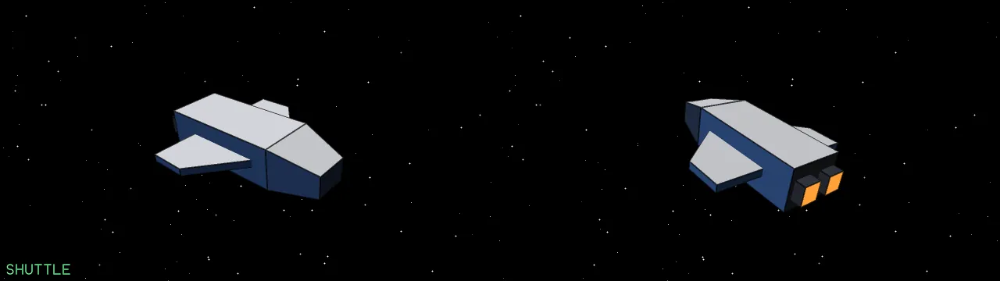{ loading=lazy }

A boxy civilian craft with short wings. It has no weapons and ferries people about the system.

| | | | |
| --- | --- | --- | --- |
| **Size** | 39.95 × 33.29 × 9.16 m | **Mass** | 12 t |
| **Top speed** | 300 m/s | **Acceleration** | 50 m/s² |
| **Pitch, roll, yaw** | 0.9, 1.2, 0.5 rad/s | **Hull** | 80 |
| **Shield** | 40 | **Energy** | 60 (+4/s) |
| **Engines** | 2 | **Combat points** | 0.06 |
| **Drops up to** | 1 canisters | **Flown as** | Trader |
| **Can be shot out** | engines, reactor | | |

### Transporter

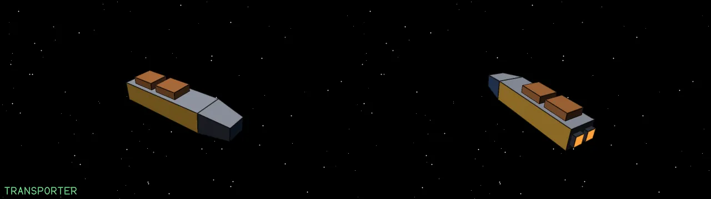{ loading=lazy }

A long hauler with containers on its back. Slow and tough, with a single laser for defence.

| | | | |
| --- | --- | --- | --- |
| **Size** | 74.69 × 17.17 × 16.31 m | **Mass** | 60 t |
| **Top speed** | 220 m/s | **Acceleration** | 30 m/s² |
| **Pitch, roll, yaw** | 0.5, 0.7, 0.3 rad/s | **Hull** | 220 |
| **Shield** | 120 | **Energy** | 120 (+5/s) |
| **Lasers** | 1 | **Engines** | 2 |
| **Combat points** | 0.07 | **Drops up to** | 4 canisters |
| **Flown as** | Trader | **Can be shot out** | engines, weapons, reactor |

### Boa

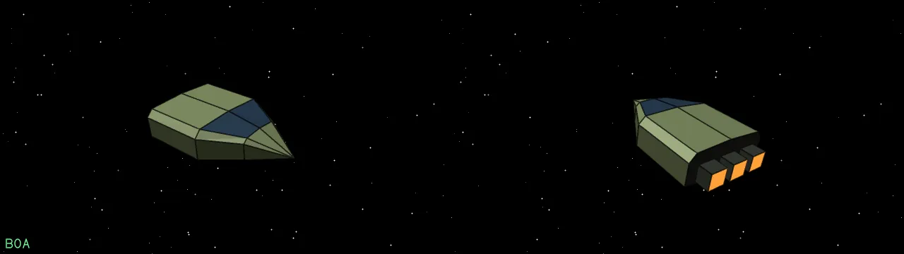{ loading=lazy }

A heavy freighter, wide, with three engines. In pirate hands it is a formidable raider.

| | | | |
| --- | --- | --- | --- |
| **Size** | 81.21 × 47.49 × 19.95 m | **Mass** | 80 t |
| **Top speed** | 260 m/s | **Acceleration** | 38 m/s² |
| **Pitch, roll, yaw** | 0.6, 0.9, 0.35 rad/s | **Hull** | 380 |
| **Shield** | 220 | **Energy** | 180 (+8/s) |
| **Lasers** | 2 | **Missiles** | 2 |
| **Engines** | 3 | **Bounty** | 250 Cr |
| **Combat points** | 0.83 | **Drops up to** | 4 canisters |
| **Flown as** | Heavy pirate | **Can be shot out** | engines, weapons, reactor |

### Anaconda

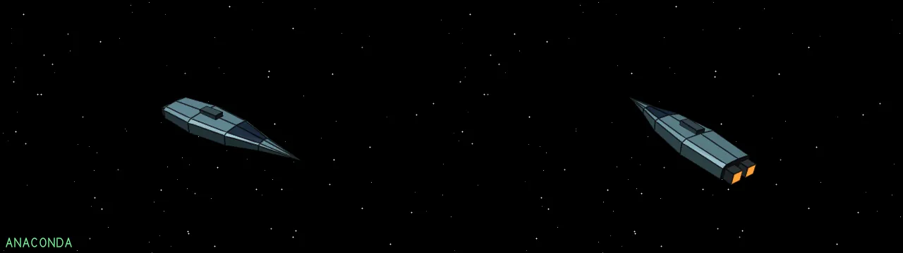{ loading=lazy }

Very long and narrow, with a dorsal turret. The biggest trader, with shields to match.

| | | | |
| --- | --- | --- | --- |
| **Size** | 125.51 × 32.33 × 17.12 m | **Mass** | 120 t |
| **Top speed** | 230 m/s | **Acceleration** | 30 m/s² |
| **Pitch, roll, yaw** | 0.5, 0.7, 0.3 rad/s | **Hull** | 520 |
| **Shield** | 350 | **Energy** | 250 (+10/s) |
| **Lasers** | 2 | **Missiles** | 2 |
| **Engines** | 2 | **Bounty** | 350 Cr |
| **Combat points** | 1 | **Drops up to** | 7 canisters |
| **Flown as** | Armed trader | **Can be shot out** | engines, weapons, reactor |

### Cobra Mk I

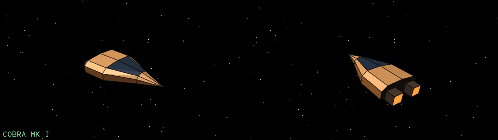{ loading=lazy }

The short, plain forerunner of the Mk III. Slower and lighter, a favourite of beginner pirates.

| | | | |
| --- | --- | --- | --- |
| **Size** | 38.37 × 19.51 × 7.15 m | **Mass** | 14 t |
| **Top speed** | 340 m/s | **Acceleration** | 60 m/s² |
| **Pitch, roll, yaw** | 1.2, 1.8, 0.7 rad/s | **Hull** | 110 |
| **Shield** | 60 | **Energy** | 70 (+5/s) |
| **Lasers** | 1 | **Missiles** | 1 |
| **Engines** | 2 | **Bounty** | 80 Cr |
| **Combat points** | 0.66 | **Drops up to** | 2 canisters |
| **Flown as** | Light pirate | **Can be shot out** | engines, weapons, reactor |

### Adder

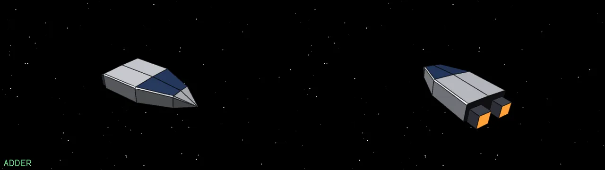{ loading=lazy }

A boxy twin-engine trader with a modest hold. Armed enough to fend off a Sidewinder.

| | | | |
| --- | --- | --- | --- |
| **Size** | 40.04 × 18.71 × 7.6 m | **Mass** | 15 t |
| **Top speed** | 360 m/s | **Acceleration** | 65 m/s² |
| **Pitch, roll, yaw** | 1.2, 1.8, 0.7 rad/s | **Hull** | 100 |
| **Shield** | 60 | **Energy** | 80 (+5/s) |
| **Lasers** | 1 | **Engines** | 2 |
| **Bounty** | 70 Cr | **Combat points** | 0.35 |
| **Drops up to** | 2 canisters | **Flown as** | Armed trader |
| **Can be shot out** | engines, weapons, reactor | | |

### Krait

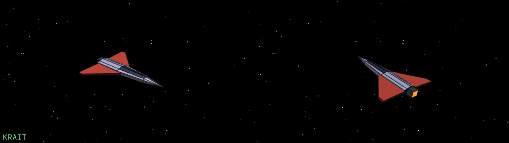{ loading=lazy }

A slim dart with swept red wings. Light, nimble and bold.

| | | | |
| --- | --- | --- | --- |
| **Size** | 33.65 × 24.26 × 2.74 m | **Mass** | 10 t |
| **Top speed** | 480 m/s | **Acceleration** | 95 m/s² |
| **Pitch, roll, yaw** | 1.8, 2.5, 0.9 rad/s | **Hull** | 85 |
| **Shield** | 60 | **Energy** | 80 (+5/s) |
| **Lasers** | 1 | **Engines** | 1 |
| **Bounty** | 100 Cr | **Combat points** | 0.33 |
| **Drops up to** | 1 canisters | **Flown as** | Light pirate |
| **Can be shot out** | engines, weapons, reactor | | |

### Gecko

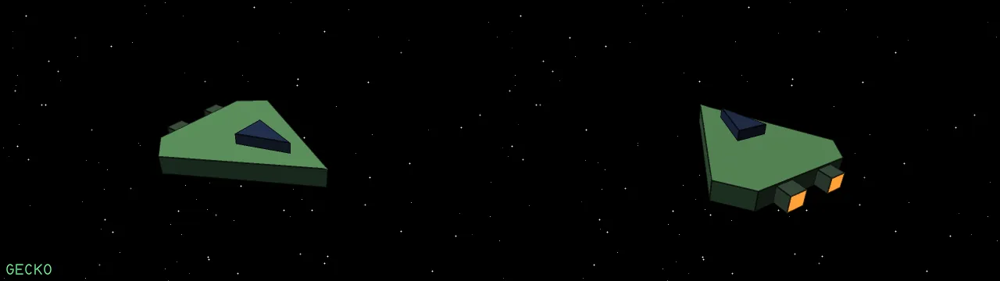{ loading=lazy }

A small kite-shaped fighter with a canopy. Quick, and cheap enough to be everywhere.

| | | | |
| --- | --- | --- | --- |
| **Size** | 29.41 × 25.67 × 5.08 m | **Mass** | 8 t |
| **Top speed** | 460 m/s | **Acceleration** | 95 m/s² |
| **Pitch, roll, yaw** | 1.9, 2.6, 0.9 rad/s | **Hull** | 65 |
| **Shield** | 40 | **Energy** | 60 (+4/s) |
| **Lasers** | 1 | **Engines** | 2 |
| **Bounty** | 55 Cr | **Combat points** | 0.33 |
| **Flown as** | Light pirate | **Can be shot out** | engines, weapons, reactor |

### Worm

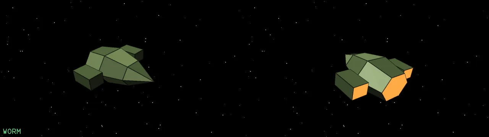{ loading=lazy }

A stubby insect-like body with side pods, flown by aliens that hunt in swarms.

| | | | |
| --- | --- | --- | --- |
| **Size** | 28.16 × 28.16 × 11.38 m | **Mass** | 9 t |
| **Top speed** | 420 m/s | **Acceleration** | 90 m/s² |
| **Pitch, roll, yaw** | 1.8, 2.4, 0.9 rad/s | **Hull** | 60 |
| **Shield** | 30 | **Energy** | 55 (+4/s) |
| **Lasers** | 1 | **Engines** | 2 |
| **Bounty** | 40 Cr | **Combat points** | 0.2 |
| **Flown as** | Alien drone | **Can be shot out** | engines, weapons, reactor |

### Asp Mk II

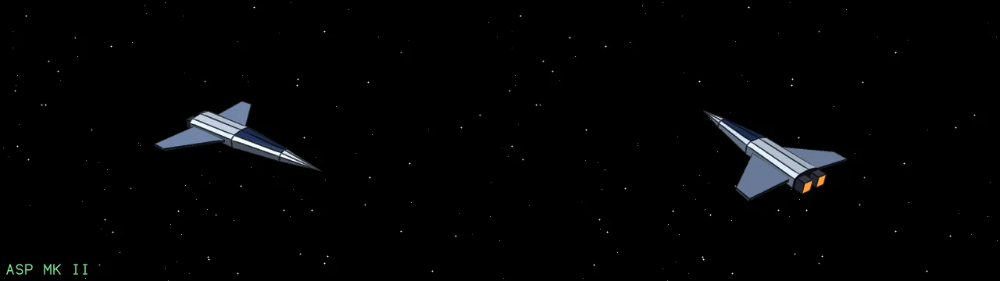{ loading=lazy }

A sleek explorer with swept wings. Fast, with good shields, so bounty hunters like it.

| | | | |
| --- | --- | --- | --- |
| **Size** | 41.61 × 31.49 × 4.05 m | **Mass** | 18 t |
| **Top speed** | 520 m/s | **Acceleration** | 100 m/s² |
| **Pitch, roll, yaw** | 1.5, 2.2, 0.8 rad/s | **Hull** | 150 |
| **Shield** | 120 | **Energy** | 130 (+7/s) |
| **Lasers** | 2 | **Missiles** | 2 |
| **Engines** | 2 | **Bounty** | 200 Cr |
| **Combat points** | 1.08 | **Drops up to** | 2 canisters |
| **Flown as** | Bounty hunter | **Can be shot out** | engines, weapons, reactor |

### Fer-de-lance

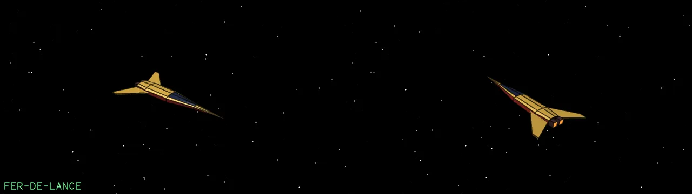{ loading=lazy }

A long dagger with gold wings. A very good fighter, flown by the more skilled pirates.

| | | | |
| --- | --- | --- | --- |
| **Size** | 48.06 × 25.47 × 3.29 m | **Mass** | 20 t |
| **Top speed** | 480 m/s | **Acceleration** | 90 m/s² |
| **Pitch, roll, yaw** | 1.4, 2, 0.8 rad/s | **Hull** | 190 |
| **Shield** | 150 | **Energy** | 150 (+8/s) |
| **Lasers** | 2 | **Missiles** | 2 |
| **Engines** | 2 | **Bounty** | 250 Cr |
| **Combat points** | 1.25 | **Drops up to** | 2 canisters |
| **Flown as** | Pirate | **Can be shot out** | engines, weapons, reactor |

### Moray

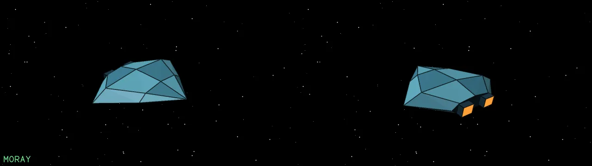{ loading=lazy }

A wide, flat, saucer-like boat. A small trader with a decent hold.

| | | | |
| --- | --- | --- | --- |
| **Size** | 38.54 × 46.25 × 8.99 m | **Mass** | 16 t |
| **Top speed** | 360 m/s | **Acceleration** | 60 m/s² |
| **Pitch, roll, yaw** | 1.1, 1.5, 0.6 rad/s | **Hull** | 130 |
| **Shield** | 80 | **Energy** | 100 (+6/s) |
| **Lasers** | 1 | **Missiles** | 1 |
| **Engines** | 2 | **Bounty** | 100 Cr |
| **Combat points** | 0.75 | **Drops up to** | 1 canisters |
| **Flown as** | Armed trader | **Can be shot out** | engines, weapons, reactor |

### Constrictor

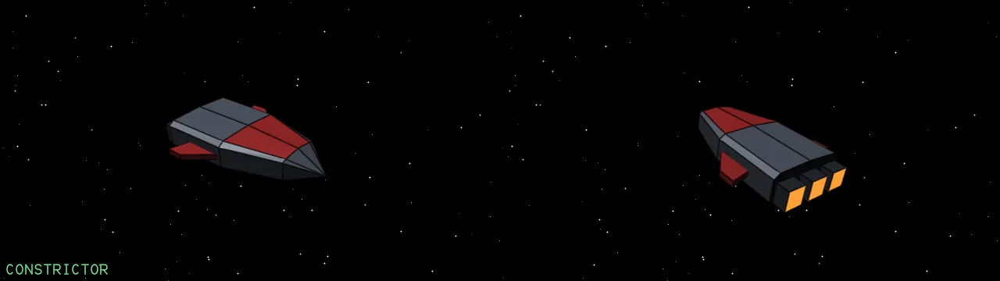{ loading=lazy }

Heavy, angular, dark with red trim: a military ship of the elite hunters. It hits hard and takes a lot of killing.

| | | | |
| --- | --- | --- | --- |
| **Size** | 52.5 × 36.57 × 10.03 m | **Mass** | 30 t |
| **Top speed** | 560 m/s | **Acceleration** | 110 m/s² |
| **Pitch, roll, yaw** | 1.5, 2.2, 0.8 rad/s | **Hull** | 450 |
| **Shield** | 350 | **Energy** | 300 (+12/s) |
| **Lasers** | 2 | **Missiles** | 4 |
| **Engines** | 3 | **Bounty** | 600 Cr |
| **Combat points** | 5.33 | **Drops up to** | 3 canisters |
| **Flown as** | Elite hunter | **Can be shot out** | engines, weapons, reactor |

### Cougar

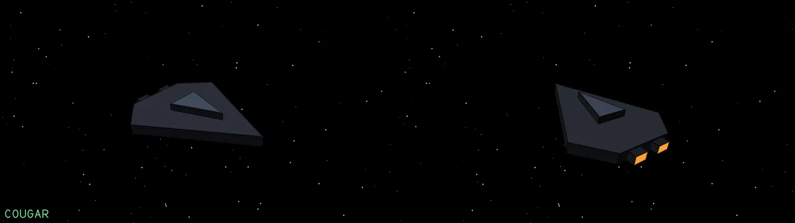{ loading=lazy }

A flat stealth wedge. Another elite hunter: hard to hit, and worth a great deal to the pilot who brings one down.

| | | | |
| --- | --- | --- | --- |
| **Size** | 51.76 × 41.26 × 6.38 m | **Mass** | 22 t |
| **Top speed** | 540 m/s | **Acceleration** | 105 m/s² |
| **Pitch, roll, yaw** | 1.6, 2.3, 0.85 rad/s | **Hull** | 380 |
| **Shield** | 300 | **Energy** | 250 (+11/s) |
| **Lasers** | 2 | **Missiles** | 4 |
| **Engines** | 2 | **Bounty** | 550 Cr |
| **Combat points** | 5.33 | **Drops up to** | 2 canisters |
| **Flown as** | Elite hunter | **Can be shot out** | engines, weapons, reactor |

### Cobra Mk III (pirate)

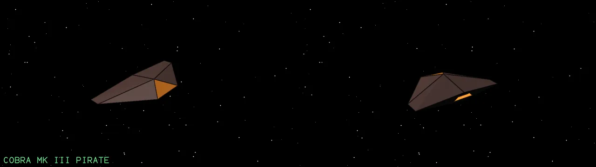{ loading=lazy }

The same Cobra Mk III model in dark pirate paint, with a missile and two lasers.

| | | | |
| --- | --- | --- | --- |
| **Size** | 22.85 × 49.49 × 6.97 m | **Mass** | 20 t |
| **Top speed** | 400 m/s | **Acceleration** | 70 m/s² |
| **Pitch, roll, yaw** | 1.3, 2, 0.7 rad/s | **Hull** | 150 |
| **Shield** | 100 | **Energy** | 110 (+6/s) |
| **Lasers** | 2 | **Missiles** | 1 |
| **Engines** | 2 | **Bounty** | 175 Cr |
| **Combat points** | 1 | **Drops up to** | 3 canisters |
| **Flown as** | Pirate | **Can be shot out** | engines, weapons, reactor |

### Python (pirate)

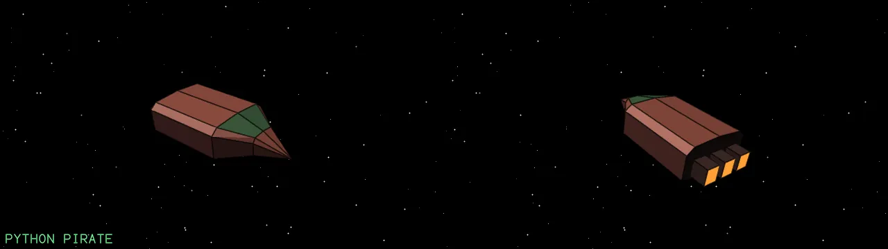{ loading=lazy }

The same Python model in dull red pirate paint. A heavy raider that is hard to put down.

| | | | |
| --- | --- | --- | --- |
| **Size** | 90.04 × 41.01 × 22.29 m | **Mass** | 90 t |
| **Top speed** | 250 m/s | **Acceleration** | 35 m/s² |
| **Pitch, roll, yaw** | 0.7, 1, 0.35 rad/s | **Hull** | 400 |
| **Shield** | 250 | **Energy** | 200 (+8/s) |
| **Lasers** | 2 | **Missiles** | 3 |
| **Engines** | 2 | **Bounty** | 300 Cr |
| **Combat points** | 1 | **Drops up to** | 5 canisters |
| **Flown as** | Heavy pirate | **Can be shot out** | engines, weapons, reactor |

## Objects in space

Things that are not ships: weapons, rocks, cargo and the emblem. They have blueprints and models like everything else.

### Missile

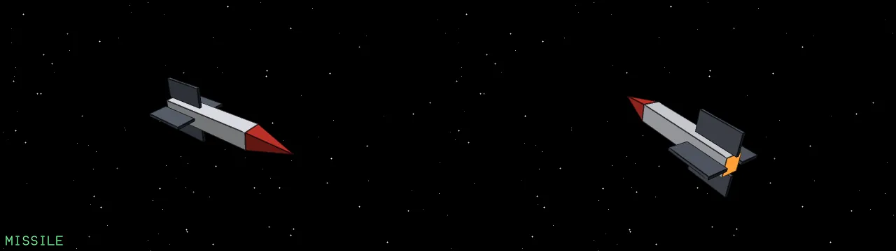{ loading=lazy }

A homing missile. It leads its target and detonates on contact. ECM can jam it.

| | | | |
| --- | --- | --- | --- |
| **Size** | 8.32 × 3.33 × 3.33 m | **Mass** | 150 kg |
| **Top speed** | 1100 m/s | **Acceleration** | 400 m/s² |
| **Pitch, roll, yaw** | 3.5, 3, 2.5 rad/s | **Hull** | 10 |
| **Energy** | 20 (+0/s) | **Combat points** | 0.2 |

### Asteroid

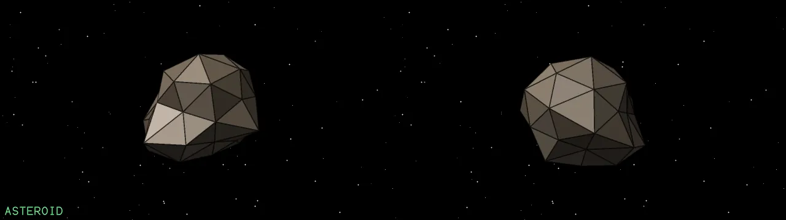{ loading=lazy }

A roughened icosphere of rock, a hazard and a source of minerals.

| | | | |
| --- | --- | --- | --- |
| **Size** | 139.53 × 139.15 × 116.91 m | **Mass** | 5,000 t |
| **Top speed** | 30 m/s | **Acceleration** | 0 m/s² |
| **Pitch, roll, yaw** | 0.05, 0.05, 0.05 rad/s | **Hull** | 300 |
| **Combat points** | 0.03 | **Drops up to** | 3 canisters |

### Cargo canister

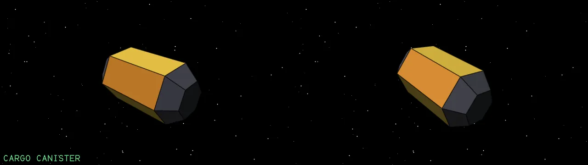{ loading=lazy }

Cargo drifting in space. Scoop it with a fuel scoop, or shoot a ship and wait for what it drops.

| | | | |
| --- | --- | --- | --- |
| **Size** | 5.1 × 2.94 × 2.55 m | **Mass** | 500 kg |
| **Top speed** | 20 m/s | **Acceleration** | 0 m/s² |
| **Pitch, roll, yaw** | 0.1, 0.1, 0.1 rad/s | **Hull** | 10 |
| **Combat points** | 0.04 | | |

### Escape pod

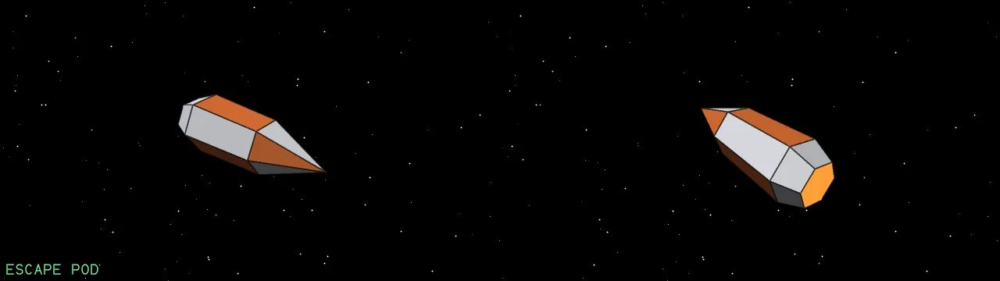{ loading=lazy }

The pilot's way out. Hold Backspace to eject; the pod drifts away from the wreck.

| | | | |
| --- | --- | --- | --- |
| **Size** | 6.97 × 2.59 × 2.24 m | **Mass** | 300 kg |
| **Top speed** | 120 m/s | **Acceleration** | 30 m/s² |
| **Pitch, roll, yaw** | 0.4, 0.4, 0.4 rad/s | **Hull** | 15 |
| **Energy** | 10 (+1/s) | **Combat points** | 0.06 |
| **Flown as** | Drifts | | |

### Alloy plate

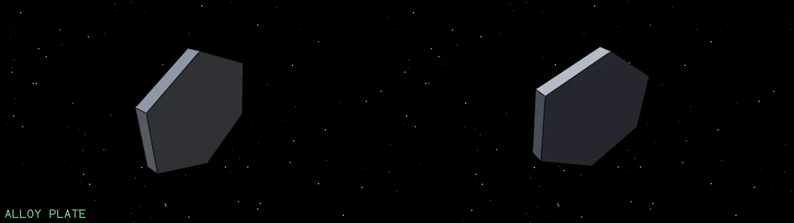{ loading=lazy }

A hexagonal slab of hull plating, left behind when a ship is shot to pieces.

| | | | |
| --- | --- | --- | --- |
| **Size** | 0.93 × 8.04 × 7.89 m | **Mass** | 800 kg |
| **Top speed** | 15 m/s | **Acceleration** | 0 m/s² |
| **Pitch, roll, yaw** | 0.1, 0.1, 0.1 rad/s | **Hull** | 20 |
| **Combat points** | 0.04 | | |

### Boulder

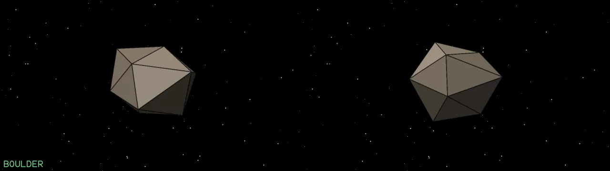{ loading=lazy }

Rock that is not split into plates, so it looks rougher than an asteroid. A medium sized lump.

| | | | |
| --- | --- | --- | --- |
| **Size** | 40.29 × 34.63 × 30.02 m | **Mass** | 400 t |
| **Top speed** | 30 m/s | **Acceleration** | 0 m/s² |
| **Pitch, roll, yaw** | 0.1, 0.1, 0.1 rad/s | **Hull** | 80 |
| **Combat points** | 0.02 | **Drops up to** | 1 canisters |

### Splinter

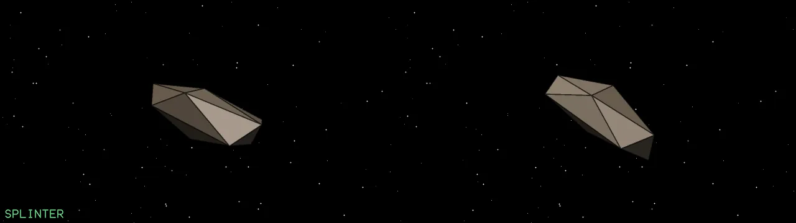{ loading=lazy }

A long thin sliver of rock, a fragment of a broken asteroid.

| | | | |
| --- | --- | --- | --- |
| **Size** | 23.6 × 8.31 × 8.78 m | **Mass** | 50 t |
| **Top speed** | 40 m/s | **Acceleration** | 0 m/s² |
| **Pitch, roll, yaw** | 0.2, 0.2, 0.2 rad/s | **Hull** | 30 |
| **Combat points** | 0.04 | | |

### Elite logo

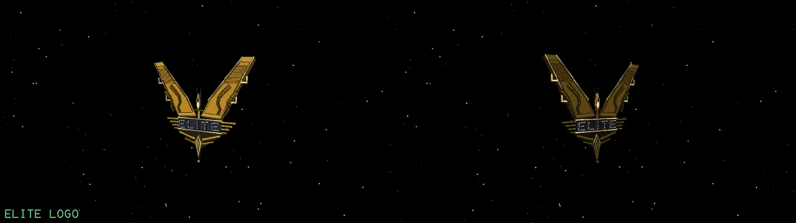{ loading=lazy }

The winged emblem: two broad swept wings with S-shaped feathers and hooks, a small ship between them and the bevelled ELITE banner, built in layers. It faces the viewer and sways. Not a ship, but an inert object.

| | | | |
| --- | --- | --- | --- |
| **Size** | 1.15 × 29.48 × 25.73 m | **Mass** | 1 t |
| **Hull** | 100 | | |

