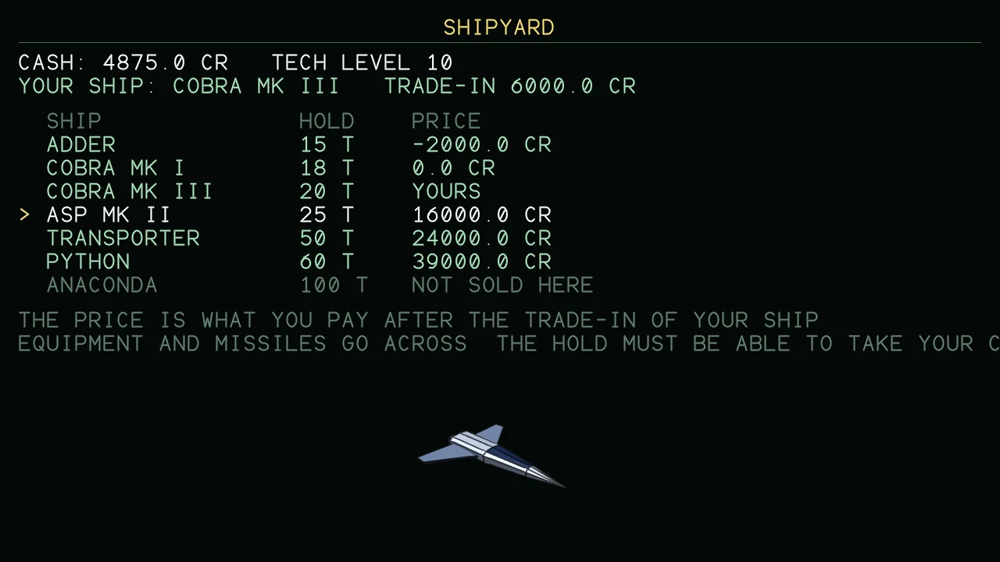
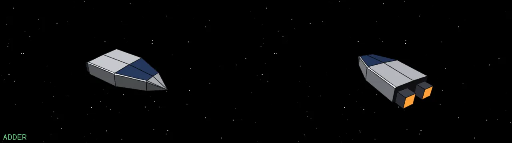
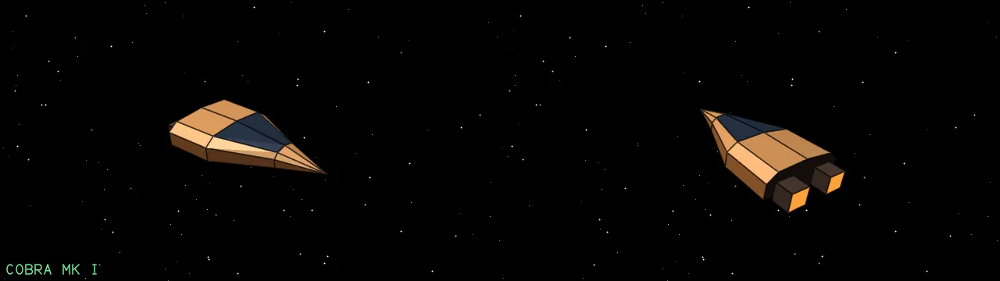
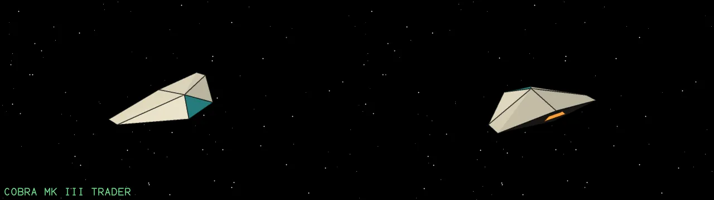
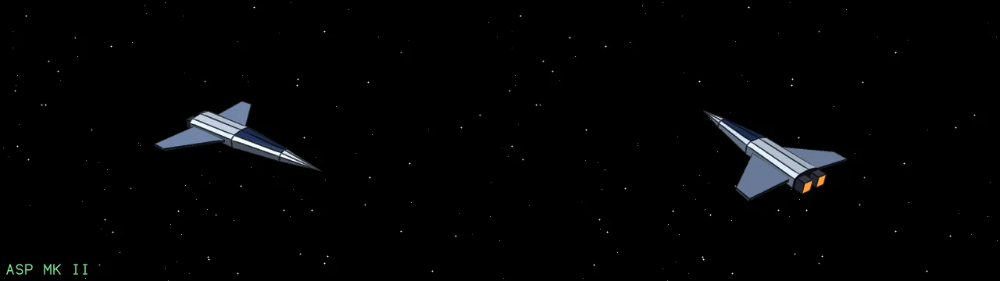
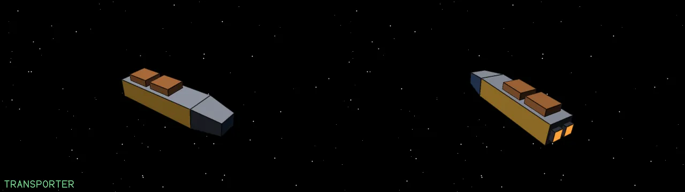
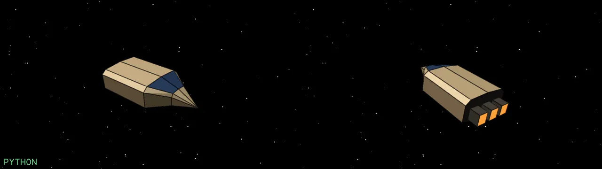
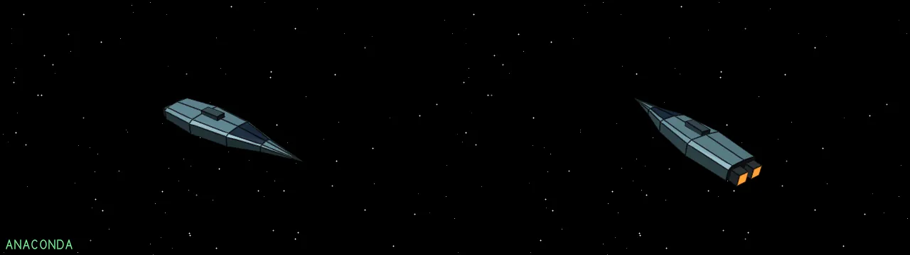

# Shipyard

Docked at a station, the shipyard screen sells other ships. You pay the price less what the yard gives for your own ship in part exchange; your equipment and missiles go across to the new one. The hold of the new ship has to be big enough for the cargo you carry (an extra cargo bay, if you have fitted one, adds its tonnes to any ship). The better ships need a system of a high tech level. Prices are in credits.

{ loading=lazy }

| Ship | Price | Hold | Top speed | Hull | Shield | Needs tech level |
| --- | --- | --- | --- | --- | --- | --- |
| [Adder](ships.md#adder) | 4000 Cr | 15 t | 360 m/s | 100 | 60 | 3 |
| [Cobra Mk I](ships.md#cobra-mk-i) | 6000 Cr | 18 t | 340 m/s | 110 | 60 | 4 |
| [Cobra Mk III (trader)](ships.md#cobra-mk-iii-trader) | 10000 Cr | 20 t | 380 m/s | 160 | 100 | 5 |
| [Asp Mk II](ships.md#asp-mk-ii) | 22000 Cr | 25 t | 520 m/s | 150 | 120 | 8 |
| [Transporter](ships.md#transporter) | 30000 Cr | 50 t | 220 m/s | 220 | 120 | 8 |
| [Python](ships.md#python) | 45000 Cr | 60 t | 250 m/s | 400 | 250 | 10 |
| [Anaconda](ships.md#anaconda) | 80000 Cr | 100 t | 230 m/s | 520 | 350 | 12 |

## The ships

### Adder

{ loading=lazy }

The yard gives 2400 Cr for it in part exchange.

### Cobra Mk I

{ loading=lazy }

The yard gives 3600 Cr for it in part exchange.

### Cobra Mk III (trader)

{ loading=lazy }

The yard gives 6000 Cr for it in part exchange.

### Asp Mk II

{ loading=lazy }

The yard gives 13200 Cr for it in part exchange.

### Transporter

{ loading=lazy }

The yard gives 18000 Cr for it in part exchange.

### Python

{ loading=lazy }

The yard gives 27000 Cr for it in part exchange.

### Anaconda

{ loading=lazy }

The yard gives 48000 Cr for it in part exchange.

