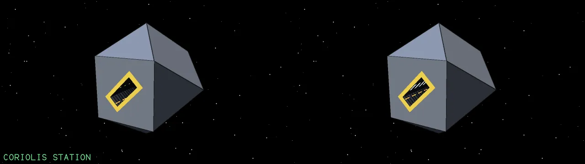
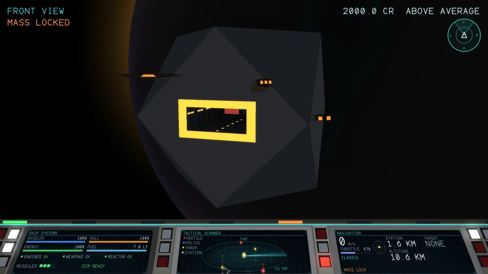
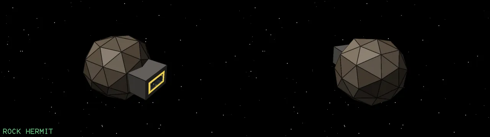
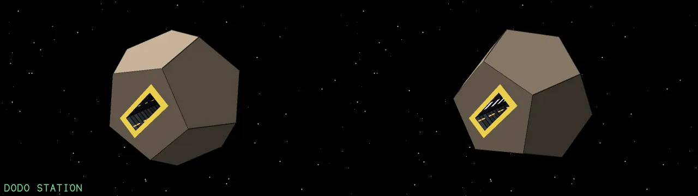
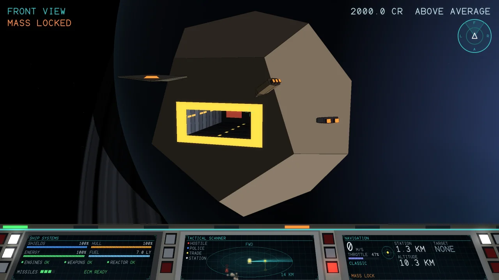
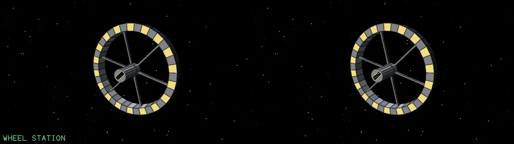
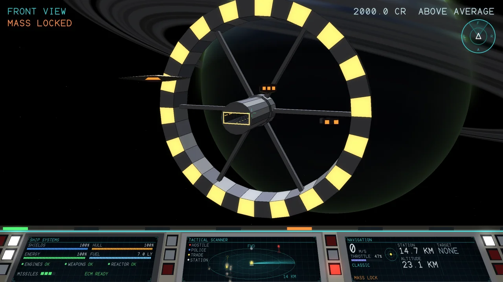

# Stations

Each system has one station, picked from the system's seed so that it is always the same one there. A station rolls slowly about its own axis and has a docking bay in its front. To dock, fly into the bay nose first, level and slowly; or switch on a docking computer (K) and let it fly you in. A tractor beam takes the ship at the mouth, draws it in and sets it down, and the station screens come up. Shoot the station and the police come.

### Coriolis station

{ loading=lazy }

The standard trading station: a cuboctahedron with a docking slot in one face, rolling slowly about its own axis. Every bay is entered nose first, level and slowly. A tractor beam takes the ship at the mouth, draws it in and sets it down on the floor.

| | | | |
| --- | --- | --- | --- |
| **Shape** | A cuboctahedron | **Size** | 707.11 × 707.11 × 707.11 m |
| **Mass** | 1,000,000 t | **Rolls once in** | 104.72 s |
| **Hull** | 20,000 | **Shield** | 20,000 |
| **Energy** | 5,000 (+100/s) | | |

Find one at Wahota, in the first galaxy.

{ loading=lazy }

### Rock hermit

{ loading=lazy }

A rock with a lit docking bay in its front: an outlaw outpost. The model and its numbers are in the game's blueprint list, but no system places one yet.

| | | | |
| --- | --- | --- | --- |
| **Shape** | A hollowed asteroid | **Size** | 324.69 × 275.09 × 262.19 m |
| **Mass** | 500,000 t | **Hull** | 800 |
| **Energy** | 100 (+5/s) | **Bounty** | 80 Cr |
| **Combat points** | 0.33 | | |

### Dodo station

{ loading=lazy }

A dodecahedron with the docking slot in one of its pentagonal faces. Smaller than the Coriolis, it also rolls about its own axis.

| | | | |
| --- | --- | --- | --- |
| **Shape** | A dodecahedron | **Size** | 635.72 × 747.34 × 785.8 m |
| **Mass** | 800,000 t | **Rolls once in** | 78.54 s |
| **Hull** | 16,000 | **Shield** | 16,000 |
| **Energy** | 4,000 (+80/s) | | |

Find one at Mikota, in the first galaxy.

{ loading=lazy }

### Wheel station

{ loading=lazy }

A rotating wheel and six spokes around a hub, with a lit docking bay at the end of a long tube at the front. Ten times the size of the Coriolis: it is drawn at the same size as the others here, but is far bigger in the game.

| | | | |
| --- | --- | --- | --- |
| **Shape** | A rotating wheel | **Size** | 3305.73 × 9480.58 × 9480.58 m |
| **Mass** | 49,999,999 t | **Rolls once in** | 209.44 s |
| **Hull** | 90,000 | **Shield** | 90,000 |
| **Energy** | 20,000 (+400/s) | | |

Find one at Lymakobi, in the first galaxy.

{ loading=lazy }

