# Trade goods

There are 17 goods to trade. The market screen draws the highlighted one in 3D to the right of the list. A price is the base price plus a step for each step of the system's economy, from rich industrial to poor agricultural, and drifts from visit to visit. Prices are in credits for a unit (tonne, kilogram or gram).

| Good | Unit | Base price | Cheaper on | Illegal |
| --- | --- | --- | --- | --- |
| [Food](#food) | t | 2.2 Cr | agricultural worlds |  |
| [Textiles](#textiles) | t | 2.8 Cr | agricultural worlds |  |
| [Radioactives](#radioactives) | t | 7 Cr | agricultural worlds |  |
| [Slaves](#slaves) | t | 4.5 Cr | agricultural worlds | yes |
| [Liquor](#liquor) | t | 9 Cr | agricultural worlds |  |
| [Luxuries](#luxuries) | t | 18 Cr | industrial worlds |  |
| [Narcotics](#narcotics) | t | 22 Cr | industrial worlds | yes |
| [Computers](#computers) | t | 15 Cr | industrial worlds |  |
| [Machinery](#machinery) | t | 11 Cr | industrial worlds |  |
| [Alloys](#alloys) | t | 8.5 Cr | industrial worlds |  |
| [Firearms](#firearms) | t | 13 Cr | industrial worlds | yes |
| [Furs](#furs) | t | 17 Cr | agricultural worlds |  |
| [Minerals](#minerals) | t | 3.6 Cr | agricultural worlds |  |
| [Gold](#gold) | kg | 10 Cr | agricultural worlds |  |
| [Platinum](#platinum) | kg | 17.5 Cr | agricultural worlds |  |
| [Gem-Stones](#gem-stones) | g | 5 Cr | agricultural worlds |  |
| [Alien Items](#alien-items) | t | 6 Cr | industrial worlds |  |

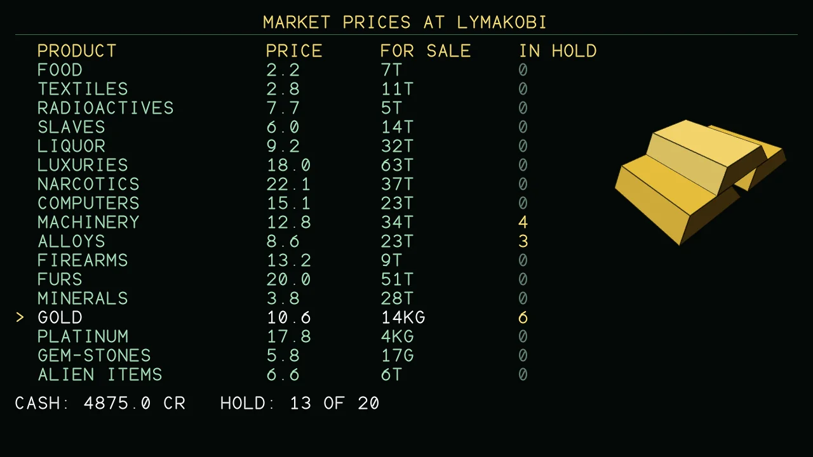{ loading=lazy }

### Food

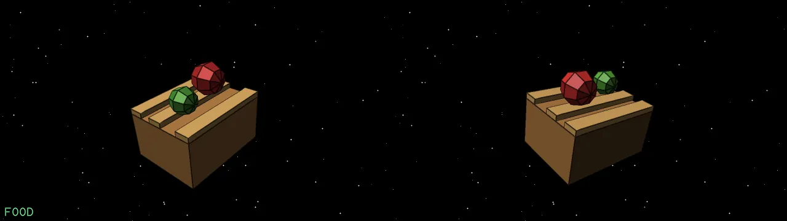{ loading=lazy }

A crate of food rations.

### Textiles

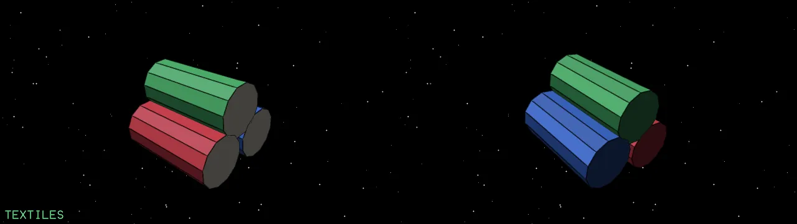{ loading=lazy }

Rolls of cloth.

### Radioactives

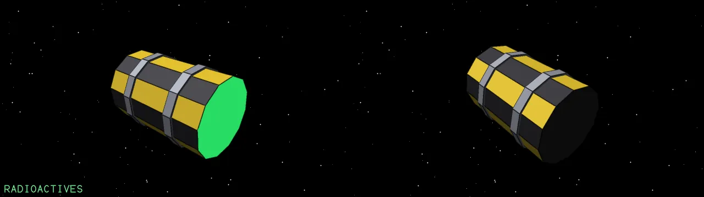{ loading=lazy }

A hazard-striped barrel.

### Slaves

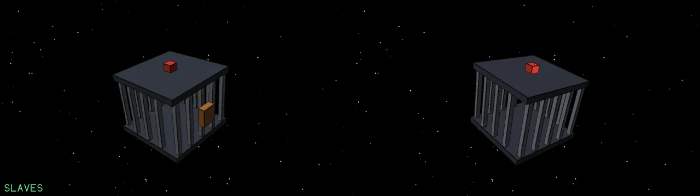{ loading=lazy }

A cage. Illegal: the police take a dim view.

### Liquor

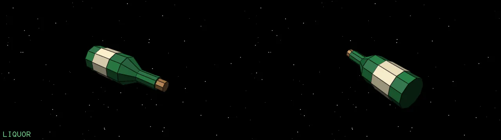{ loading=lazy }

A bottle of liquor.

### Luxuries

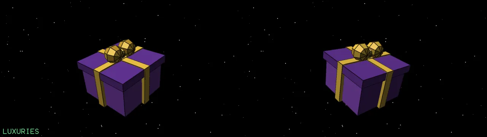{ loading=lazy }

A gift box.

### Narcotics

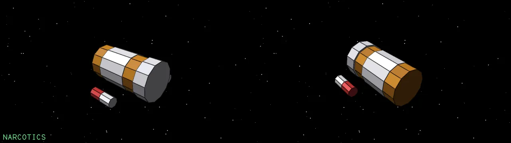{ loading=lazy }

A pill bottle. Illegal: the police take a dim view.

### Computers

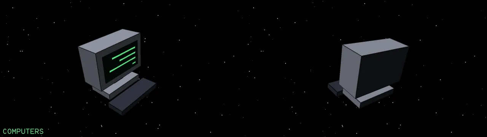{ loading=lazy }

A monitor.

### Machinery

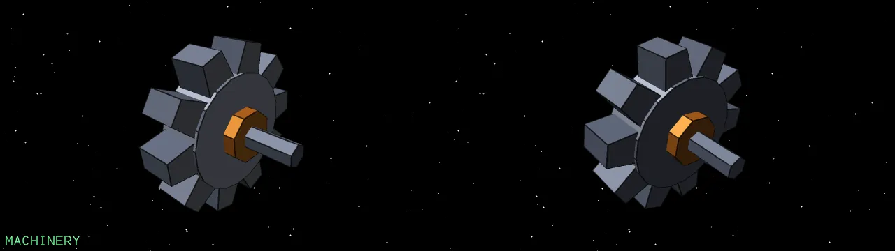{ loading=lazy }

A gear.

### Alloys

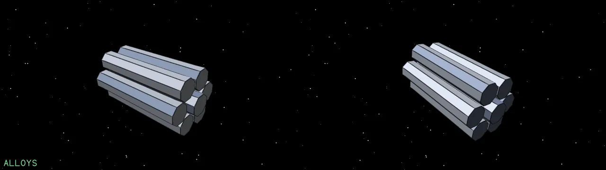{ loading=lazy }

A bundle of alloy rods.

### Firearms

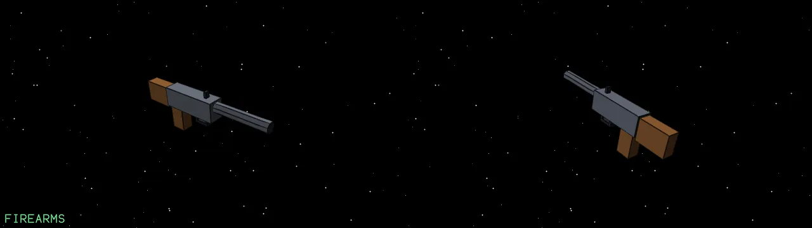{ loading=lazy }

A rifle. Illegal: the police take a dim view.

### Furs

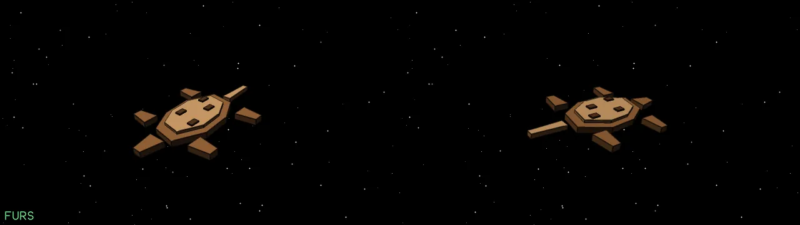{ loading=lazy }

A pelt.

### Minerals

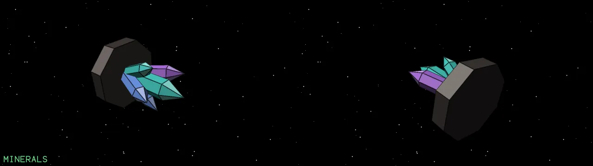{ loading=lazy }

Raw mineral crystals.

### Gold

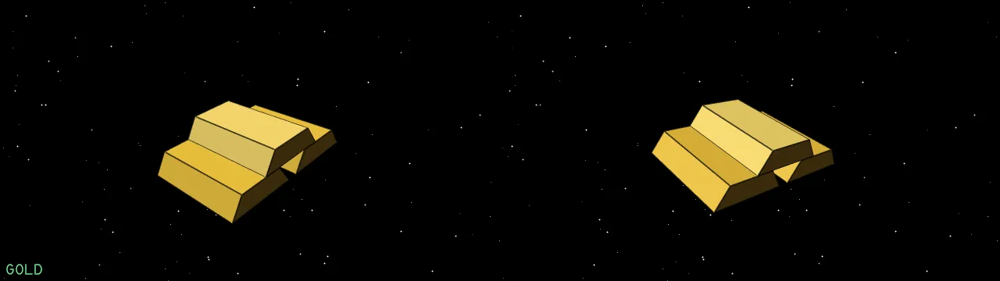{ loading=lazy }

Stacked gold bars, sold by the kilogram.

### Platinum

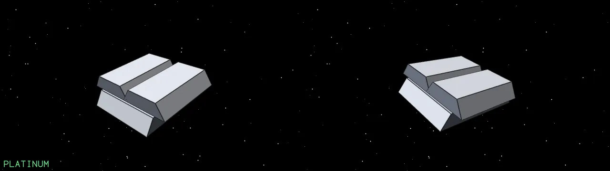{ loading=lazy }

Platinum bars, sold by the kilogram.

### Gem-Stones

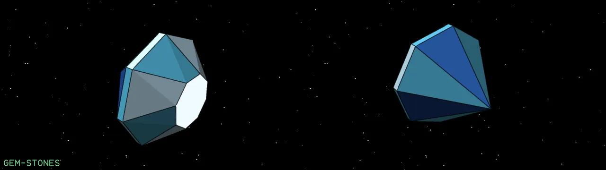{ loading=lazy }

A cut gem, sold by the gram.

### Alien Items

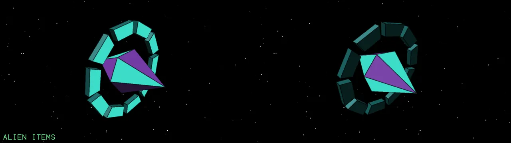{ loading=lazy }

A glowing alien relic. Only the more advanced worlds (tech level 8 and up) have any.

