# Upgrades

What the equipment screen sells, each as a 3D model drawn from two sides, the same one the screen shows under the list. A system sells an item only if its tech level is high enough. Prices are in credits.

| Item | Price | Needs tech level |
| --- | --- | --- |
| [Missile](#missile) | 30 Cr | 1 |
| [ECM](#ecm) | 600 Cr | 3 |
| [Fuel scoop](#fuel-scoop) | 525 Cr | 5 |
| [Docking computer](#docking-computer) | 1500 Cr | 9 |
| [Energy bomb](#energy-bomb) | 900 Cr | 7 |
| [Escape pod](#escape-pod) | 1000 Cr | 3 |
| [Beam laser](#beam-laser) | 1000 Cr | 7 |
| [Military laser](#military-laser) | 6000 Cr | 10 |
| [Fuel](#fuel) | 2 Cr a light year | 1 |
| [Extra cargo bay](#extra-cargo-bay) | 400 Cr | 5 |
| [Galactic hyperdrive](#galactic-hyperdrive) | 5000 Cr | 10 |

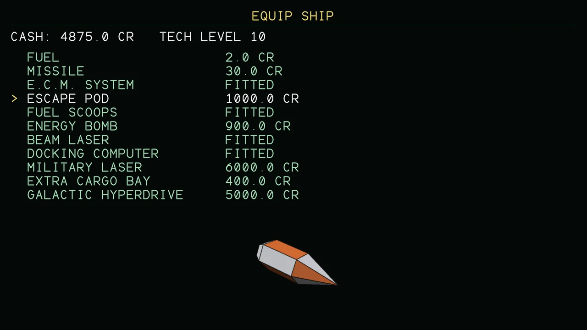{ loading=lazy }

### Missile

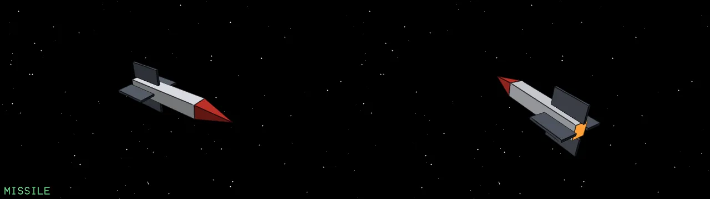{ loading=lazy }

A homing missile that leads its target. Lock on with T, fire with M. ECM jams it.

### ECM

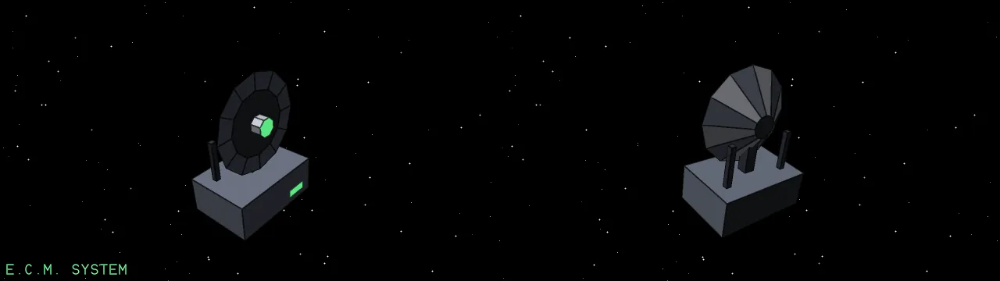{ loading=lazy }

Electronic counter-measures: jams every missile locked on to the ship. Press C.

### Fuel scoop

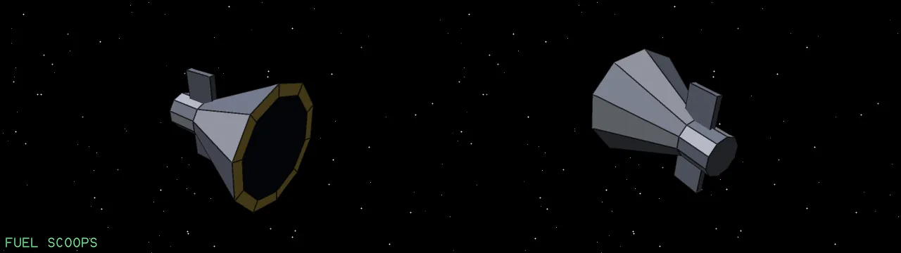{ loading=lazy }

Scoops cargo canisters, and with them the cargo of your kills, into the hold.

### Docking computer

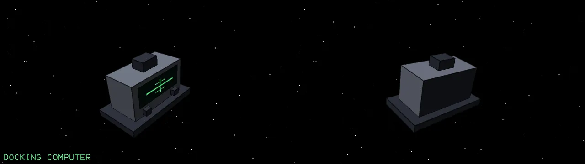{ loading=lazy }

Flies the ship into the station's bay for you. Press K and watch.

### Energy bomb

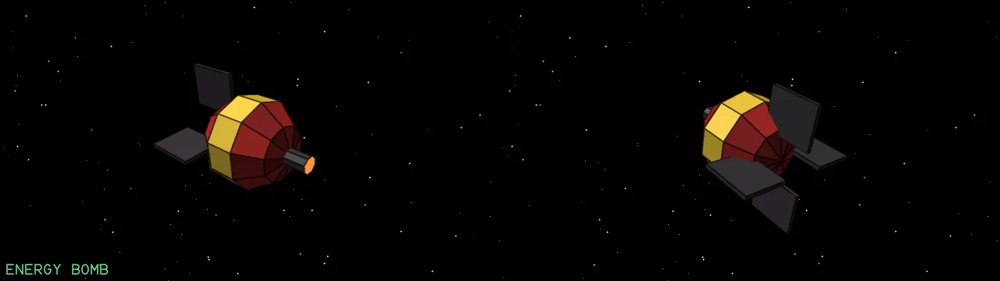{ loading=lazy }

Destroys everything nearby that is not a station or a planet. Press B, and be sure.

### Escape pod

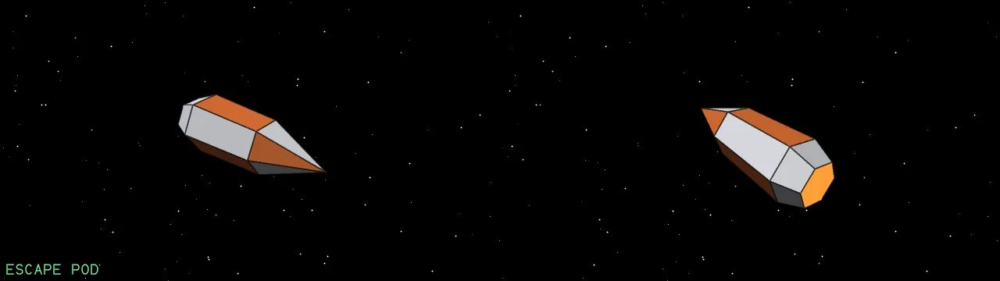{ loading=lazy }

Hold Backspace to eject when the ship is lost: the pilot survives.

### Beam laser

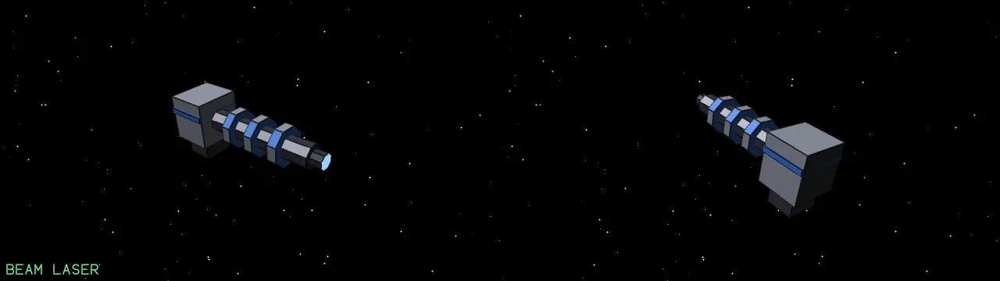{ loading=lazy }

A better laser than the pulse laser the ship comes with: 26 damage a shot against 18.

### Military laser

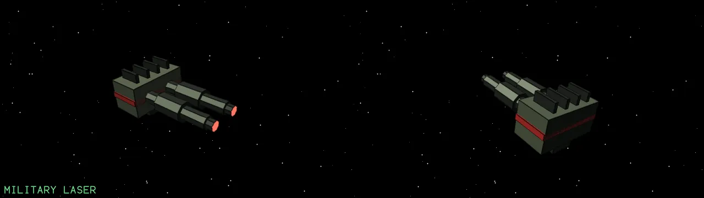{ loading=lazy }

The best laser in the game: 34 damage a shot.

### Fuel

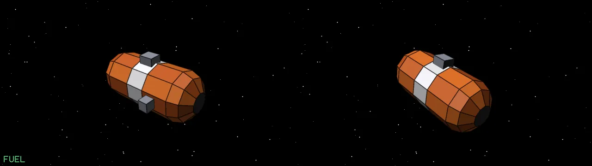{ loading=lazy }

Fuel for hyperspace, sold by the light year.

### Extra cargo bay

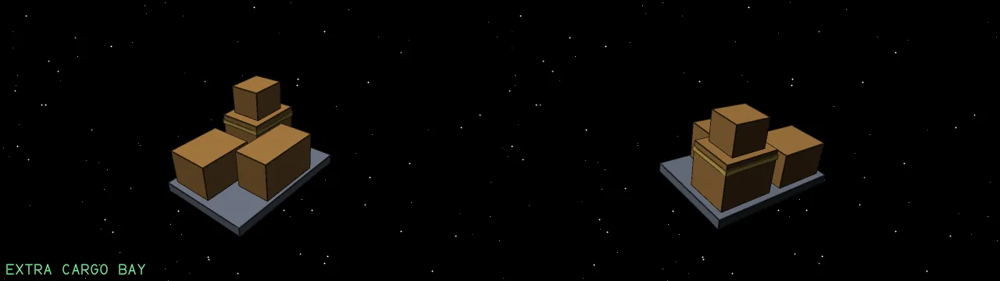{ loading=lazy }

Fifteen more tonnes of hold. It stays with you when you change ship.

### Galactic hyperdrive

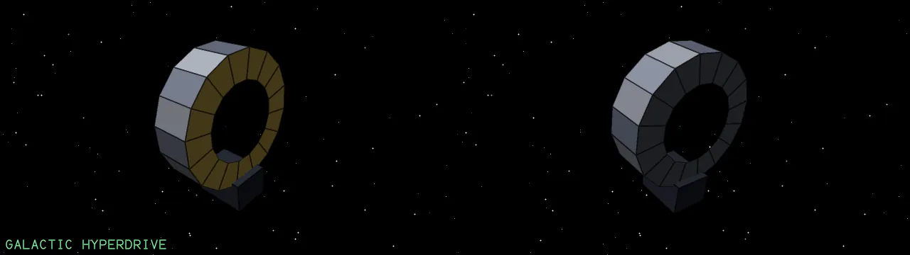{ loading=lazy }

Press J in flight to jump to the next galaxy: the ship arrives at the system nearest the same place on the chart. It uses no fuel, and the drive is used up.

